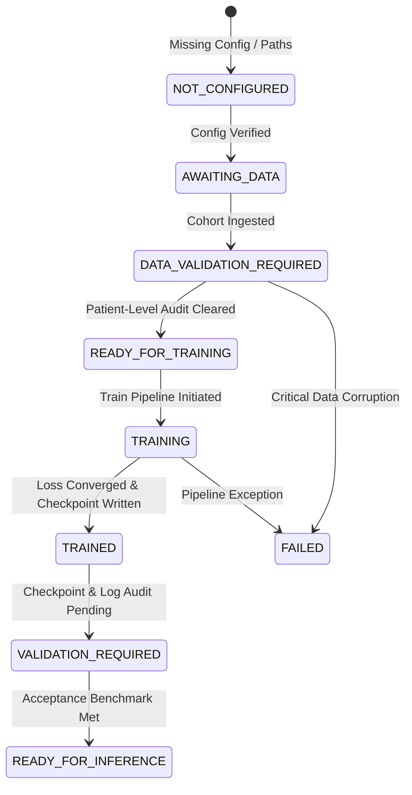

# OsteoGuard AI — Backend and ML Infrastructure Setup Guide

## 1. Overview
OsteoGuard AI employs a decoupled, microservice-ready backend architecture for multi-class bone pathology classification (**Secondary Bone Metastasis**, **Paget's Disease of Bone**, **Osteogenesis Imperfecta**, and **Healthy Skeletal Control**) and biomechanical fracture risk stratification.

The ML backend is built using **FastAPI**, **PyTorch**, **IBSI-compliant radiomics**, and **Pydantic V2**, serving both operational monitoring APIs (`/api/ml/*`) and real-time inference endpoints (`/api/v1/*`).

```
                              ┌─────────────────────────────┐
                              │    React / Vite Frontend    │
                              │     (Port 5173 / 3000)      │
                              └──────────────┬──────────────┘
                                             │ HTTP REST
                                             ▼
                              ┌─────────────────────────────┐
                              │  FastAPI ML Infrastructure  │
                              │         (Port 8000)         │
                              └──────┬───────┬───────┬──────┘
                                     │       │       │
              ┌──────────────────────┘       │       └──────────────────────┐
              ▼                              ▼                              ▼
    ┌──────────────────┐           ┌──────────────────┐           ┌──────────────────┐
    │ Health & Status  │           │ Dataset Gate     │           │ Model State      │
    │ /api/ml/health   │           │ /api/ml/datasets │           │ /api/ml/models   │
    │ /api/ml/status   │           │ Audit & Blocker  │           │ Finite State     │
    └──────────────────┘           └──────────────────┘           └──────────────────┘
```

---

## 2. Directory Layout

The ML service is encapsulated within `ml_service/`, operating alongside the persistent artifact repository in `ml_artifacts/`:

```
ml_service/
├── app/
│   ├── api/
│   │   └── v1/
│   │       ├── __init__.py
│   │       └── ml_routes.py         # Endpoints: /api/ml/health, /status, /datasets, /models
│   ├── schemas/
│   │   ├── __init__.py
│   │   ├── model_state.py          # 9-state finite state machine Enum
│   │   └── ml_status.py            # Typed Pydantic request/response schemas
│   ├── services/
│   │   ├── __init__.py
│   │   └── readiness_service.py    # Zero-dataset audits & lifecycle evaluation
│   ├── __init__.py
│   └── main.py                     # FastAPI application factory & error middleware
├── config/
│   ├── __init__.py
│   └── settings.py                 # Pydantic BaseSettings loading from .env
├── data/
│   ├── raw/                        # Ingested clinical imaging cohorts (DICOM / PNG)
│   ├── interim/                    # Normalized & windowed intermediate representations
│   ├── processed/                  # Standardized tensors ready for training
│   └── splits/                     # Stratified patient-level train/val/test splits
├── datasets/                       # PyTorch Dataset and DataLoader implementations
├── preprocessing/                  # Modality-specific normalization (CT / X-ray / Bone Scan)
├── segmentation/                   # U-Net skeletal ROI extraction models
├── models/                         # ResNet-101 (512-D) and Swin Transformer backbones
├── radiomics/                      # 102-D IBSI-aligned feature extraction engine
├── fusion/                         # 614-D multimodal late fusion network
├── training/                       # Multiclass Focal Loss trainer & validation loops
├── evaluation/                     # Confusion matrices, ROC-AUC, calibration curves
├── explainability/                 # Grad-CAM saliency & TreeSHAP attributions
├── inference/                      # Production inference pipelines & safety gates
├── utils/
│   ├── __init__.py
│   ├── exceptions.py               # Standardized OsteoGuard exception hierarchy
│   └── logging.py                  # Structured JSON & contextual logging
├── tests/                          # Automated backend & readiness test suite
├── requirements.txt                # Production Python dependencies
└── .env.example                    # Environment variable template

ml_artifacts/
├── checkpoints/                    # Verified model weights (.pt / .pth)
├── metrics/                        # Quantitative validation & test metrics
├── logs/                           # Training execution & audit logs
└── stage_reports/                  # Verifiable milestone documentation
```

---

## 3. Environment Prerequisites

- **Python Version**: Python 3.10, 3.11, 3.12, or 3.13.
- **Hardware Acceleration**: CPU (supported out-of-the-box) or NVIDIA GPU with CUDA 11.8+ / 12.1+.
- **Node.js** (Optional, for frontend): Node 20+ LTS.

---

## 4. Installation & Setup

### 4.1 Create and Activate a Virtual Environment

```bash
# Windows (PowerShell)
python -m venv .venv
.\.venv\Scripts\Activate.ps1

# Linux / macOS
python3 -m venv .venv
source .venv/bin/activate
```

### 4.2 Install Dependencies

```bash
# Production dependencies
pip install -r requirements.txt

# Development and testing dependencies
pip install -r requirements-dev.txt

# Editable local package installation
pip install -e .
```

### 4.3 Configure Environment Variables

Copy `.env.example` to `.env` in the repository root or configure environment variables directly:

```bash
cp .env.example .env
```

Key environment configuration variables:

| Variable | Default Value | Description |
| :--- | :--- | :--- |
| `OSTEO_SERVICE_NAME` | `OsteoGuard AI ML Service` | Service identifier name |
| `OSTEO_ENV` | `development` | Environment: `development`, `staging`, `production` |
| `OSTEO_HOST` | `0.0.0.0` | Network interface address |
| `OSTEO_PORT` | `8000` | HTTP listening port |
| `OSTEO_LOG_LEVEL` | `INFO` | Logging verbosity (`DEBUG`, `INFO`, `WARNING`, `ERROR`) |
| `OSTEO_ACTIVE_BACKBONE` | `resnet101` | Semantic backbone (`resnet101` or `swin_transformer`) |
| `OSTEO_DEVICE` | `cpu` | Target compute device (`cpu` or `cuda`) |
| `OSTEO_FUSION_DIM` | `614` | Total late fusion dimension (512 semantic + 102 radiomics) |
| `OSTEO_RADIOMICS_DIM` | `102` | IBSI-compliant radiomic vector length |
| `OSTEO_MIN_PATIENTS_PER_CLASS` | `10` | Minimum unique patients required per disease class |
| `OSTEO_ENABLE_MOCK_FALLBACK` | `false` | Must remain `false` in production to prevent fake metrics |

---

## 5. Running the Backend Service

To launch the FastAPI service using Uvicorn:

```bash
# Standard launch
python -m uvicorn ml_service.app.main:app --host 0.0.0.0 --port 8000 --reload
```

Once launched:
- **Interactive OpenAPI Documentation (Swagger UI)**: [http://localhost:8000/docs](http://localhost:8000/docs)
- **ReDoc Technical Specification**: [http://localhost:8000/redoc](http://localhost:8000/redoc)
- **Service Root**: [http://localhost:8000/](http://localhost:8000/)

---

## 6. API Reference

### 6.1 GET `/api/ml/health`
Checks runtime health, version, uptime, and PyTorch hardware acceleration.
- **Response `200 OK`**:
```json
{
  "status": "ok",
  "service": "OsteoGuard AI ML Service",
  "version": "1.0.0",
  "timestamp": "2026-11-15T02:30:00Z",
  "environment": "development",
  "device": "cpu",
  "uptime_seconds": 12.4
}
```

### 6.2 GET `/api/ml/status`
Returns high-level status of the entire ML pipeline, active model state, and dataset state.
- **Response `200 OK`**:
```json
{
  "status": "awaiting_data",
  "service": "OsteoGuard AI ML Service",
  "version": "1.0.0",
  "timestamp": "2026-11-15T02:30:00Z",
  "model_state": "AWAITING_DATA",
  "dataset_state": "EMPTY",
  "active_backbone": "resnet101",
  "device": "cpu",
  "sample_count": 0,
  "patient_count": 0,
  "weights_loaded": false,
  "can_train": false,
  "can_infer": false,
  "message": "Model is AWAITING_DATA. Currently zero clinical datasets exist on disk..."
}
```

### 6.3 GET `/api/ml/datasets/status`
Performs an audit of on-disk clinical cohorts, patient stratification counts, and class balance.
- **Response `200 OK`**:
```json
{
  "status": "EMPTY",
  "dataset_path": "ml_service/data/raw",
  "sample_count": 0,
  "patient_count": 0,
  "classes_present": {
    "metastasis": 0,
    "paget": 0,
    "oi": 0,
    "healthy": 0
  },
  "missing_classes": ["metastasis", "paget", "oi", "healthy"],
  "is_ready": false,
  "validation_passed": false,
  "blockers": [
    "ZERO real medical image samples detected on disk.",
    "Strict Rule 4 & 5: No synthetic images or fake labels may be substituted.",
    "Training cannot proceed without authentic medical images."
  ],
  "action_required": [
    "Download authentic clinical imaging datasets.",
    "Follow modality standardization guidelines (CT: WL +400/WW 1500; X-ray: CLAHE)."
  ]
}
```

### 6.4 GET `/api/ml/models/status`
Returns the active state of the model lifecycle, checkpoint verification, and inference clearance.
- **Response `200 OK`**:
```json
{
  "model_state": "AWAITING_DATA",
  "active_backbone": "resnet101",
  "weights_loaded": false,
  "checkpoint_path": null,
  "checkpoint_verified": false,
  "architecture": {
    "backbone": "resnet101",
    "radiomics_features": 102,
    "semantic_features": 512,
    "total_fusion_dim": 614,
    "num_classes": 4,
    "target_classes": ["metastasis", "paget", "oi", "healthy"]
  },
  "can_infer": false,
  "can_train": false,
  "training_history_available": false,
  "message": "Model is AWAITING_DATA. Currently zero clinical datasets exist on disk...",
  "blockers": [
    "No clinical dataset downloaded. State is AWAITING_DATA.",
    "No trained model checkpoints exist in ml_artifacts/checkpoints/."
  ]
}
```

### 6.5 POST `/api/v1/analyze` (Gated Diagnostic Endpoint)
Submits a planar radiograph, CT slice, or bone scan for multi-class differential diagnosis.
- **Current Behavior (Zero-Dataset State)**:
  - Fails with **HTTP 503 Service Unavailable** (`MODEL_NOT_READY`).
  - Returns explicit error details explaining that no authenticated model checkpoints exist on disk.
  - **Zero fake predictions or synthetic confidence percentages are returned.**

---

## 7. Model State Machine Lifecycle

The backend enforces 9 mutually exclusive finite states:



1. `NOT_CONFIGURED`: Service paths or configuration values cannot be resolved.
2. `AWAITING_DATA`: Configuration valid, but physical image directories contain 0 samples.
3. `DATA_VALIDATION_REQUIRED`: Images detected, but missing classes, unverified patient metadata, or modality conflicts remain.
4. `READY_FOR_TRAINING`: Cohort verified across all 4 classes with $\ge 10$ unique patients per class.
5. `TRAINING`: Training loop is actively executing.
6. `TRAINED`: Training loop complete and weights saved to `ml_artifacts/checkpoints/`.
7. `VALIDATION_REQUIRED`: Checkpoint exists, but benchmark evaluation and log verification are pending.
8. `READY_FOR_INFERENCE`: Authentic weights verified with matching training logs and accepted test metrics.
9. `FAILED`: Unrecoverable exception during dataset processing, training, or checkpoint evaluation.

---

## 8. Strict Zero-Dataset Medical AI Governance

OsteoGuard AI enforces strict clinical AI safety rules:
- **Rule 4**: Never invent dataset labels or patient records.
- **Rule 5**: Never use generated synthetic images as real training data.
- **Rule 6**: Never claim that a model has been trained unless actual training logs and checkpoints exist.
- **Rule 7**: Never fabricate evaluation metrics or generate fake confidence percentages.

Under zero downloaded clinical datasets, `readiness_service` hard-blocks training clearance (`can_train = False`) and inference clearance (`can_infer = False`). Attempts to query `/api/v1/analyze` return HTTP 503 with a structured error payload.

---

## 9. Running Automated Tests

To run the complete automated test suite (including both `ml_service/tests` and `tests_ml`):

```bash
# Run all tests
python -m pytest ml_service/tests tests_ml -v

# Run with test coverage
python -m pytest ml_service/tests tests_ml --cov=ml_service --cov=osteoguard
```

---

## 10. Frontend Integration (LiveEngine)

The React frontend SPA incorporates a `LiveEngine` (`src/engine/LiveEngine.ts`) that probes the live backend.
To connect the frontend to this FastAPI ML service:
1. Ensure the FastAPI service is running on port 8000:
   ```bash
   python -m uvicorn ml_service.app.main:app --port 8000
   ```
2. In the frontend environment file (`osteophorosis-main/.env`):
   ```bash
   VITE_API_BASE_URL_LIVE=http://localhost:8000
   ```
3. `LiveEngine.checkAvailability()` calls `/api/health`, receiving status `ok`, and displays the active backend connection in the UI.
