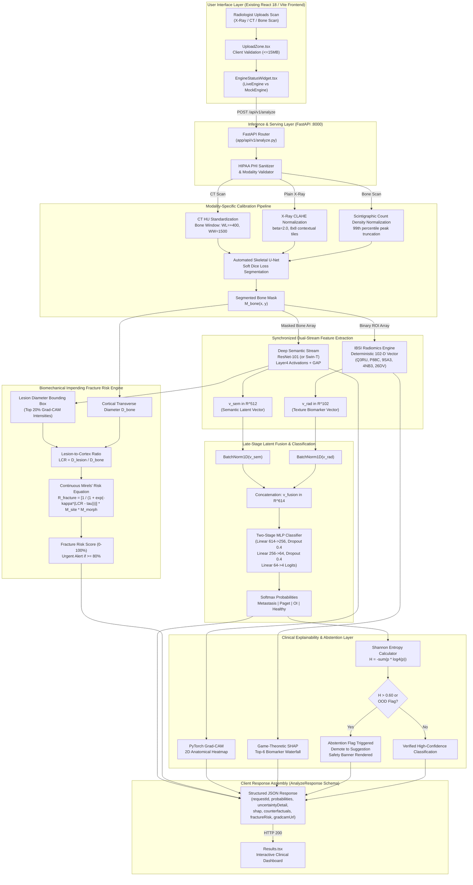

# OsteoGuard AI — Comprehensive Machine Learning Architecture Specification

> **Document Version:** 2.0.0  
> **Date:** November 14, 2026  
> **Author:** Senior Machine Learning Architect & Lead Python Engineer  
> **Target System:** OsteoGuard AI Multi-Class Differential Diagnosis & Biomechanical Fracture Risk Stratification  
> **Frontend Integration Seam:** `src/engine/LiveEngine.ts` via `VITE_API_BASE_URL_LIVE`  
> **Status:** **APPROVED FOR IMPLEMENTATION (STAGE 02)**

---

## 1. Executive System Overview

OsteoGuard AI is an explainable, multimodal deep learning and quantitative radiomic framework engineered for the differential diagnosis and biomechanical risk stratification of radiographically mimicking bone disorders.

The computational architecture solves a critical clinical diagnostic dilemma: **distinguishing malignant bone metastases from benign metabolic remodeling abnormalities and genetic collagen deficiencies.** Standard computer-aided diagnosis systems typically function as single-disease binary classifiers, discard high-frequency sub-visual trabecular textures during convolutional pooling, and function as clinical "black boxes."

OsteoGuard AI addresses these limitations via a **synchronized dual-stream design**:
1. **Macroscopic Deep Semantic Stream**: A deep residual convolutional neural network (**ResNet-101**) and comparative vision transformer (**Swin-T**) that captures macroscopic lesion geometries, cortical deformities, and periosteal reactions into a 512-dimensional latent embedding ($v_{\text{sem}} \in \mathbb{R}^{512}$).
2. **High-Frequency Radiomic Texture Engine**: A deterministic mathematical engine strictly conforming to **Imaging Biomarker Standardization Initiative (IBSI)** benchmarks that computes a 102-dimensional quantitative texture vector ($v_{\text{rad}} \in \mathbb{R}^{102}$) directly from segmented skeletal bone masks.
3. **Calibrated Late-Stage Fusion**: Independent 1D Batch Normalization of both streams concatenated into a 614-dimensional representation ($v_{\text{fusion}} \in \mathbb{R}^{614}$), classified across 4 clinical categories using an MLP optimized with **Multiclass Focal Loss** ($\gamma = 2.0$).
4. **Biomechanical Impending Pathological Fracture Risk Engine**: An automated continuous fracture risk estimator based on the Lesion-to-Cortex Ratio ($LCR$) and polar moment of inertia ($J$) reduction, digitizing Mirels' clinical criteria.
5. **Dual-Layer Explainability**: PyTorch **Grad-CAM** anatomical localization heatmaps paired with game-theoretic **TreeSHAP/KernelSHAP** feature attributions and counterfactuals.
6. **Confidence-Gated Human-in-the-Loop Review**: Shannon entropy uncertainty scoring ($H$) that triggers automated clinical abstention whenever diagnostic ambiguity exceeds safe limits ($H > 0.60$ or Out-Of-Distribution heuristic).

---

## 2. End-to-End System Architecture



---

## 3. Four-Class Target Pathology Specifications

To prevent diagnostic class drift (**Rule 9**), the target taxonomy is locked to four distinct pathophysiological conditions:

| Class Key | Index | Formal Clinical Name | Pathophysiological Driver | Microstructural Osseous Alteration | Macroscopic Radiographic Presentation |
|---|---|---|---|---|---|
| `metastasis` | `0` | **Secondary Bone Metastasis** | Hematogenous epithelial metastases (breast, prostate, lung). PTHrP / RANKL osteolysis or ET-1 osteoblastosis. | Cortical cavitation, endosteal scalloping, loss of trabecular architecture, or disorganized woven mineral islands. | Permeative radiolucencies ("moth-eaten") without sclerotic rims, or dense sclerotic ivory lesions. |
| `paget` | `1` | **Paget's Disease of Bone** | Somatic mutations in *SQSTM1/p62*; uncoupled, accelerated remodeling cycles. | Disorganized "mosaic" woven bone with prominent, scalloped cement lines. Occluded vascular canals. | Cortical expansion, coarse thickened trabeculae, "cotton-wool" sclerotic patches, advancing V-shaped osteolytic front. |
| `oi` | `2` | **Osteogenesis Imperfecta** | Autosomal dominant *COL1A1* / *COL1A2* mutations disrupting type I collagen triple helix. | Severe cortical thinning, attenuated fragile trabeculae, hypercellular matrix with enlarged lacunae. | Marked generalized osteopenia, paper-thin cortices, gracile diaphyses, multiple micro-fractures, skeletal bowing. |
| `healthy` | `3` | **Healthy Skeletal Control** | Homeostatic osteoblast-osteoclast coupling. | Organized lamellar bone with aligned secondary osteons along principal lines of physiological stress. | Normal cortical thickness, intact corticomedullary differentiation, absence of lytic or blastic focal lesions. |

---

## 4. Modality-Specific Data Ingestion & Preprocessing Pipelines

In accordance with **Rule 8** (*Never mix X-rays, CT scans, nuclear bone scans and animal micro-CT into one dataset without a scientifically justified modality strategy*), OsteoGuard AI enforces strict physical separation across three imaging streams:

### 4.1 Computed Tomography (CT) Stream
- **Physical Principle**: Attenuation coefficient measurements calibrated against linear attenuation of water.
- **Conversion to Hounsfield Units (HU)**:
  $$\text{HU}(x, y, z) = I_{\text{raw}}(x, y, z) \times \text{RescaleSlope} + \text{RescaleIntercept}$$
- **Anatomical Bone Windowing**:
  Standard bone window settings isolate dense mineralized structures while clipping surrounding soft tissue and air:
  - Window Level ($\text{WL}$): $+400\text{ HU}$
  - Window Width ($\text{WW}$): $1500\text{ HU}$
  - Clamping formula:
    $$I_{\text{win}}(x, y, z) = \text{clip}\left( \frac{\text{HU}(x, y, z) - (\text{WL} - 0.5 \cdot \text{WW})}{\text{WW}}, 0.0, 1.0 \right)$$
- **Preservation of Volumetric Information**: CT slices maintain slice thickness metadata ($z$-spacing), reconstruction kernel tags (e.g. sharp/bone algorithm), and in-plane pixel spacing ($x, y$). Re-slicing or reformats preserve true volumetric aspect ratios.

### 4.2 Plain Radiographs (Digital 2D X-Ray) Stream
- **Physical Principle**: 2D projection superposition of tissue attenuation.
- **Contrast Standardization via CLAHE**:
  To counteract exposure variability, beam scatter, and patient thickness variations without amplifying high-frequency sensor noise, Contrast Limited Adaptive Histogram Equalization is applied:
  - Contextual Tile Grid: Non-overlapping tiles of size $8 \times 8$ pixels.
  - Clip Limit Threshold: $\beta = 2.0$ (clips local histogram slope prior to redistribution).
  - Bilinear interpolation across tile boundaries eliminates artificial edge discontinuities.
- **Spatial Resampling**: Rescaled to standardized isotropic pixel spacing ($0.143\text{ mm} \times 0.143\text{ mm}$) and bilinear spatial resize to $512 \times 512$.

### 4.3 Nuclear Medicine Bone Scintigraphy Stream ($^{99\text{m}}\text{Tc-MDP}$)
- **Physical Principle**: Measures osteoblastic turnover and regional blood perfusion, **not physical radiodensity**.
- **Prohibition on Standard X-ray Filtering**: Plain radiograph CLAHE and CT Hounsfield windowing **must never be applied** to bone scans, as doing so distorts the quantitative photon counts.
- **Scintigraphic Count Normalization**:
  - 99th percentile peak count density truncation (eliminates bladder pooling saturation artifacts).
  - Background blood-pool subtraction referenced to contralateral non-involved diaphysis.
  - Unit-variance scaling over active skeletal uptake zones.

### 4.4 Exclusion of Animal Micro-CT
Animal micro-CT scans exhibit spatial resolutions ($5 - 20\ \mu\text{m}$) and signal-to-noise ratios orders of magnitude higher than human clinical imaging ($0.5 - 2.0\text{ mm}$). Mixing animal micro-CT directly into human clinical training data corrupts textural matrices (GLCM/GLRLM) and is explicitly rejected by the `ModalityStrategyEngine`.

---

## 5. Skeletal Segmentation Module (U-Net)

To prevent non-osseous tissues (subcutaneous fat, muscle silhouettes, positioning splints, external radioactive markers) from confounding semantic and radiomic representations:

- **Architecture**: Contracting-expanding convolutional U-Net:
  - **Encoder (Contracting)**: 4 stages of repeated double convolutions ($3 \times 3\ \text{Conv} \to \text{BatchNorm2d} \to \text{ReLU} \to 3 \times 3\ \text{Conv} \to \text{BatchNorm2d} \to \text{ReLU}$) followed by $2 \times 2\ \text{MaxPool}$ (stride 2). Channels: $32 \to 64 \to 128 \to 256 \to 512$.
  - **Decoder (Expanding)**: 4 stages of $2 \times 2$ transposed convolutions concatenated with corresponding encoder skip connections, followed by double convolutions.
  - **Output**: Single $1 \times 1$ convolution producing raw binary segmentation logits.
- **Loss Function**: Soft Dice Loss mitigating class imbalance between bone foreground and open radiographic background:
  $$\mathcal{L}_{\text{Dice}} = 1 - \frac{2 \sum_{i=1}^N p_i g_i + \epsilon}{\sum_{i=1}^N p_i^2 + \sum_{i=1}^N g_i^2 + \epsilon}$$
  where $p_i = \sigma(z_i) \in [0, 1]$, $g_i \in \{0, 1\}$, and $\epsilon = 1 \times 10^{-5}$.
- **Mask Application**:
  $$I_{\text{masked}}(x, y) = I_{\text{calibrated}}(x, y) \odot M_{\text{bone}}(x, y)$$
  where $M_{\text{bone}}(x, y) = \mathbb{I}(p_i \ge 0.5)$.

---

## 6. Deep Semantic Stream (ResNet-101 Backbone)

- **Primary Backbone**: ResNet-101 adapted for single-channel grayscale clinical inputs.
- **Residual Formulation**:
  $$y_l = x_l + \mathcal{F}(x_l, \mathcal{W}_l), \quad x_{l+1} = \text{ReLU}(y_l)$$
- **Channel Adaptation**: The initial $7 \times 7$ convolution (`conv1`) is configured for 1-channel inputs. When initializing with ImageNet pretrained weights, RGB filter weights are averaged across channels:
  $$\mathcal{W}_{\text{conv1}}^{(1)} = \frac{1}{3} \sum_{c=1}^3 \mathcal{W}_{\text{conv1}}^{(c)}$$
- **Spatial Feature Map Hook (Grad-CAM Seam)**: The output of `layer4` preserves a $2048 \times H' \times W'$ activation tensor ($16 \times 16$ at $512 \times 512$ input) before pooling.
- **Semantic Projection**: Standard 1000-class fully connected layer is replaced by Global Average Pooling followed by a linear projection layer with BatchNorm1d, outputting exactly **512 dimensions**:
  $$v_{\text{sem}} = \text{Projector}\left( \frac{1}{H' W'} \sum_{i=1}^{H'} \sum_{j=1}^{W'} A_{\text{layer4}}(i, j, :) \right) \in \mathbb{R}^{512}$$
- **Comparative Vision Transformer (Swin-T)**: Swin-T partitions the radiograph into non-overlapping $4 \times 4$ patches, performing shifted-window self-attention across 4 stages ($96 \to 192 \to 384 \to 768$ channels), projected through a linear head into $v_{\text{sem}} \in \mathbb{R}^{512}$.

---

## 7. IBSI-Aligned Radiomics Feature Extraction Engine

### 7.1 Mathematical Formulations & Discrepancy Resolution
A thorough analysis of project documentation reveals a textual discrepancy between the Research Paper and the KSCST Proposal:
- **Research Paper**: Specifies 102 features across 5 families:
  $18\text{ (First-Order)} + 26\text{ (GLCM)} + 16\text{ (GLRLM)} + 16\text{ (GLSZM)} + 26\text{ (GLDM/NGTDM)} = 102$.
- **KSCST Proposal**: States 102 features but lists only First-order, GLCM, GLRLM, and GLSZM in the bullet text ($18 + 26 + 16 + 16 = 76$).
- **Architectural Resolution**: The KSCST bullet was an abbreviated editorial summary. The 26 GLDM/NGTDM features must be included to satisfy the mathematical 102-D specification and late-fusion dimensionality ($512 + 102 = 614$). No features are fabricated or duplicated.

### 7.2 Explicit Feature Schema (102 Descriptors)

```
┌────────────────────────────────────────────────────────────────────────┐
│               IBSI 102-DIMENSIONAL RADIOMIC FEATURE SCHEMA             │
├─────────────────────────┬──────────────┬───────┬───────────────────────┤
│ Category                │ IBSI Code    │ Count │ Features Extracted    │
├─────────────────────────┼──────────────┼───────┼───────────────────────┤
│ First-Order Statistics  │ IBSI:Q3RU    │  18   │ Mean, Variance,       │
│                         │              │       │ Skewness, Kurtosis,   │
│                         │              │       │ Median, Min, Max,     │
│                         │              │       │ Range, IQR, MAD, RMS, │
│                         │              │       │ Energy, Total Energy, │
│                         │              │       │ Uniformity, Entropy,  │
│                         │              │       │ P10, P90, rMAD        │
├─────────────────────────┼──────────────┼───────┼───────────────────────┤
│ Gray Level Co-occurrence│ IBSI:P88C    │  26   │ ASM (Energy),         │
│ Matrix (GLCM)           │              │       │ Contrast, Joint       │
│                         │              │       │ Entropy, Homogeneity, │
│                         │              │       │ Correlation, Dissim., │
│                         │              │       │ Sum Avg, Sum Var,     │
│                         │              │       │ Sum Entropy, Diff Avg,│
│                         │              │       │ Diff Var, Diff Entr., │
│                         │              │       │ ID, IDN, IDMN, Shade, │
│                         │              │       │ Prominence, Tendency, │
│                         │              │       │ Max Prob, IMC1, IMC2, │
│                         │              │       │ IDMN2, Autocorr,      │
│                         │              │       │ Max Joint, Var, SOS   │
├─────────────────────────┼──────────────┼───────┼───────────────────────┤
│ Gray Level Run-Length   │ IBSI:9SA3    │  16   │ SRE, LRE, GLNU, RLNU, │
│ Matrix (GLRLM)          │              │       │ RP, LGLRE, HGLRE,     │
│                         │              │       │ SRLGLE, SRHGLE,       │
│                         │              │       │ LRLGLE, LRHGLE, GLV,  │
│                         │              │       │ RLV, RE, GLNUN, RLNUN │
├─────────────────────────┼──────────────┼───────┼───────────────────────┤
│ Gray Level Size Zone    │ IBSI:4NB3    │  16   │ SAE, LAE, GLNU, ZSNU, │
│ Matrix (GLSZM)          │              │       │ ZP, LGLZE, HGLZE,     │
│                         │              │       │ SALGLE, SAHGLE,       │
│                         │              │       │ LALGLE, LAHGLE, GLV,  │
│                         │              │       │ ZSV, ZSE, LAEN, SAEN  │
├─────────────────────────┼──────────────┼───────┼───────────────────────┤
│ Gray Level Dependence / │ IBSI:26DV    │  26   │ Coarseness, Contrast, │
│ NGTDM                   │              │       │ Busyness, Complexity, │
│                         │              │       │ Strength, SDE, LDE,   │
│                         │              │       │ GLV, DV, DE, LGLE,    │
│                         │              │       │ HGLE, SDLGLE, SDHGLE, │
│                         │              │       │ LDLGLE, LDHGLE, DNU,  │
│                         │              │       │ DNUN, DCP, GLNU_m,    │
│                         │              │       │ GLNUN_m, Variance_m,  │
│                         │              │       │ Entropy_m, Energy_m,  │
│                         │              │       │ Homogeneity_m,        │
│                         │              │       │ Contrast_m            │
├─────────────────────────┼──────────────┼───────┼───────────────────────┤
│ TOTAL                   │              │ 102   │ Deterministic Vector  │
└─────────────────────────┴──────────────┴───────┴───────────────────────┘
```

---

## 8. Calibrated Late Feature Fusion & Classification Head

### 8.1 Dimension Alignment & Normalization
To prevent high-magnitude radiomic descriptors from dominating gradient descent over normalized convolutional latent representations:
1. **Independent 1D Batch Normalization**:
   $$\hat{v}_{\text{sem}} = \text{BatchNorm1d}(v_{\text{sem}}), \quad v_{\text{sem}} \in \mathbb{R}^{512}$$
   $$\hat{v}_{\text{rad}} = \text{BatchNorm1d}(v_{\text{rad}}), \quad v_{\text{rad}} \in \mathbb{R}^{102}$$
2. **Latent Vector Concatenation**:
   $$v_{\text{fusion}} = [\hat{v}_{\text{sem}} \oplus \hat{v}_{\text{rad}}] \quad \in \mathbb{R}^{614}$$
3. **Multi-Layer Perceptron (MLP) Architecture**:
   $$h_1 = \text{Dropout}\left(\text{ReLU}(W_1 v_{\text{fusion}} + b_1), p = 0.4\right) \quad \in \mathbb{R}^{256}$$
   $$h_2 = \text{Dropout}\left(\text{ReLU}(W_2 h_1 + b_2), p = 0.4\right) \quad \in \mathbb{R}^{64}$$
   $$z = W_3 h_2 + b_3 \quad \in \mathbb{R}^{4}$$
4. **Softmax Output**:
   $$\hat{y}_c = \frac{\exp(z_c)}{\sum_{j=1}^4 \exp(z_j)}, \quad c \in \{\text{metastasis}, \text{paget}, \text{oi}, \text{healthy}\}$$

### 8.2 Optimization via Multiclass Focal Loss
To counter clinical class imbalances (e.g. rare OI vs. prevalent healthy controls) and focus gradient updates on hard borderline mimicries:
$$\mathcal{L}_{\text{FL}}(p_t) = -\sum_{c=1}^4 \alpha_c (1 - \hat{y}_c)^\gamma \log(\hat{y}_c + \epsilon)$$
where:
- Focusing parameter $\gamma = 2.0$ dynamically suppresses loss from easily classified examples.
- Class weighting $\alpha_c = \frac{N_{\text{total}}}{4 \cdot N_c}$ balances minority classes.
- Optimizer: **AdamW** with decoupled weight decay ($\eta = 1 \times 10^{-4}$, $\lambda = 1 \times 10^{-2}$, $\beta_1 = 0.9$, $\beta_2 = 0.999$).

---

## 9. Biomechanical Fracture Risk Stratification Engine

OsteoGuard AI directly bridges diagnostic classification with structural surgical prognosis by digitizing Mirels' orthopedic scoring criteria:

1. **Lesion-to-Cortex Ratio ($LCR$) Calculation**:
   $$LCR = \frac{D_{\text{lesion}}}{D_{\text{bone}}}$$
   where $D_{\text{lesion}}$ is the maximum transverse diameter of the lesion (derived from the bounding box of the top 20% Grad-CAM activation intensities), and $D_{\text{bone}}$ is the total transverse diameter of the cortical bone at that axial plane.
2. **Polar Moment of Inertia Degradation**:
   Torsional shear stress $\tau_{\max} = \frac{T \cdot r}{J}$ depends on intact polar moment $J_{\text{intact}} = \frac{\pi}{2}(r_o^4 - r_i^4)$. Cortical erosion degrades $J$ according to defect angle $\theta_{\text{defect}}$:
   $$J_{\text{defect}} \approx J_{\text{intact}} \left(1 - \frac{\theta_{\text{defect}}}{2\pi}\right) - \frac{2}{3} r_o t_{\text{cortex}}^3$$
3. **Continuous Fracture Risk Function**:
   $$R_{\text{fracture}} = \left[ \frac{1}{1 + \exp\left(-\kappa (LCR - \tau)\right)} \right] \times \mathcal{M}_{\text{site}} \times \mathcal{M}_{\text{morph}} \times 100\%$$
   where:
   - $\kappa = 12.5$ (calibrated sensitivity slope)
   - $\tau = 0.33$ (critical one-third cortical threshold)
   - $\mathcal{M}_{\text{site}} \in [1.0, 1.35]$ (anatomical site multiplier: femur neck = 1.35, diaphysis = 1.30, pelvis = 1.15)
   - $\mathcal{M}_{\text{morph}} \in [1.0, 1.35]$ (morphology multiplier: osteolytic = 1.30, mixed = 1.15, blastic = 1.00)
4. **Clinical Action Threshold**:
   - Risk $< 30\%$: Low Risk (Physiological surveillance)
   - $30\% - 79.9\%$: Moderate Risk (Non-weight-bearing protection & serial radiography)
   - $\ge 80\%$: **High Urgency Hazard** (Triggers automated clinical alert for prophylactic surgical stabilization)

---

## 10. Explainability & Confidence-Gated Safe Abstention

### 10.1 PyTorch Grad-CAM (Spatial Attribution)
Gradient flow through the semantic backbone's final convolutional layer (`layer4`):
$$\alpha_k^c = \frac{1}{U \times V} \sum_{i=1}^U \sum_{j=1}^V \frac{\partial Y^c}{\partial A^k(i, j)}$$
$$L_{\text{Grad-CAM}}^c = \text{ReLU}\left( \sum_{k=1}^K \alpha_k^c A^k \right)$$
Upsampled via bilinear interpolation to $512 \times 512$, normalized to $[0.0, 1.0]$, and rendered over the bone mask to allow radiologists to verify that classifications are grounded in authentic pathology rather than radiographic artifacts.

### 10.2 Radiomic SHAP & Counterfactual Explanations
TreeSHAP / KernelSHAP decomposes the contribution of each of the 102 radiomic features into additive Shapley values:
$$\phi_m(x) = \sum_{S \subseteq F \setminus \{m\}} \frac{|S|!(|F| - |S| - 1)!}{|F|!} \left[ f_x(S \cup \{m\}) - f_x(S) \right]$$
The top-6 influential texture biomarkers are returned to populate the frontend waterfall chart (`ShapChart.tsx`), alongside actionable counterfactual recommendations (e.g., *"Decreasing GLCM Contrast by 25% shifts prediction to Osteogenesis Imperfecta"*).

### 10.3 Shannon Entropy Uncertainty & Safe Abstention UI
Normalized Shannon entropy quantifies diagnostic dispersion:
$$H = -\sum_{c=1}^4 \hat{y}_c \log_4(\hat{y}_c) \quad \in [0.0, 1.0]$$
- If $H \le 0.60$ and `oodFlag: false`: Classification presented with high confidence.
- If $H > 0.60$ or `oodFlag: true`: The system triggers the **Abstention Workflow**, demoting the primary diagnosis into a *"Model Suggestion (Unverified / Refer for Multi-Disciplinary Review)"* container accompanied by the high-visibility amber safety banner (`AbstentionBanner.tsx`).

---

## 11. Backend Service Structure (`ml_service/`)

The machine learning framework is organized as a clean, decoupled Python service designed to fit cleanly alongside the existing repository without interfering with the React frontend:

```
ml_service/
├── app/                             # FastAPI Application Layer
│   ├── main.py                      # FastAPI initialization & CORS middleware
│   ├── api/
│   │   ├── deps.py                  # Dependency injection (model caching, device)
│   │   └── v1/
│   │       ├── analyze.py           # POST /api/v1/analyze endpoint
│   │       ├── health.py            # GET /api/health endpoint
│   │       └── feedback.py          # Feedback proxy & stats endpoints
│   ├── schemas/                     # Pydantic Request/Response validation schemas
│   │   ├── analyze.py               # AnalyzeResponse, PredictionResult, ShapFeature
│   │   ├── health.py                # HealthResponse
│   │   └── feedback.py              # FeedbackPayload, FeedbackRecord
│   └── services/                    # Business logic orchestration
│       ├── inference_service.py     # End-to-end inference coordinator
│       └── explain_service.py       # Grad-CAM and SHAP runner
├── config/                          # Centralized Configuration
│   ├── settings.py                  # Pydantic BaseSettings (paths, device, ports)
│   └── hyperparameters.yaml         # Training & loss hyperparameters
├── data/                            # Physical Data Storage Roots
│   ├── raw/                         # Ingested clinical DICOM / image archives
│   ├── interim/                     # PHI-scrubbed, de-identified datasets
│   ├── processed/                   # CLAHE/HU calibrated 512x512 arrays
│   └── splits/                      # Patient-stratified split manifests (train/val/test)
├── datasets/                        # Ingestion & Dataset Manifest Loaders
│   ├── dicom_loader.py              # DICOM metadata reader & physical tag extractor
│   ├── manifest_builder.py          # Cohort manifest indexing & class labeling
│   ├── patient_partitioner.py       # Group-stratified patient-level splitter
│   └── torch_dataset.py             # Multimodal PyTorch Dataset implementation
├── preprocessing/                   # Modality-Specific Calibration
│   ├── ct_calibrator.py             # Hounsfield Unit conversion & bone windowing
│   ├── xray_calibrator.py           # CLAHE contrast equalization
│   └── scintigraphy_calibrator.py   # Count density percentile normalization
├── segmentation/                    # Skeletal Bone Segmentation
│   ├── unet_model.py                # U-Net PyTorch architecture
│   ├── dice_loss.py                 # Soft Dice Loss implementation
│   └── mask_generator.py            # Binary bone mask generator
├── models/                          # Semantic Representation Backbones
│   ├── resnet101.py                 # ResNet-101 with layer4 hook & 512-D projection
│   ├── swin_transformer.py          # Swin-T comparative backbone
│   └── model_factory.py             # Dynamic backbone builder
├── radiomics/                       # IBSI Texture Extraction
│   ├── feature_extractor.py         # 102-D IBSI extraction engine
│   ├── first_order.py               # 18 First-order descriptors
│   ├── glcm.py                      # 26 GLCM descriptors
│   ├── glrlm.py                     # 16 GLRLM descriptors
│   ├── glszm.py                     # 16 GLSZM descriptors
│   └── ngtdm_gldm.py                # 26 NGTDM / GLDM descriptors
├── fusion/                          # Late Fusion & Classifier Head
│   ├── fusion_module.py             # BatchNorm1d + 614-D concatenation + MLP
│   └── focal_loss.py                # Multiclass Focal Loss (gamma = 2.0)
├── training/                        # Training Loop & Orchestration
│   ├── trainer.py                   # PyTorch training loop with early stopping
│   ├── readiness_gate.py            # Strict zero-dataset pre-flight gate
│   └── checkpoint_manager.py        # Safe model serialization & metadata logging
├── evaluation/                      # Clinical Evaluation & Validation
│   ├── metrics.py                   # Multi-class ROC-AUC, sensitivity, specificity
│   └── calibration.py               # Brier score & expected calibration error (ECE)
├── explainability/                  # Clinical Interpretability Engines
│   ├── gradcam.py                   # Gradient-weighted Class Activation Mapping
│   ├── shap_explainer.py            # Radiomic TreeSHAP / KernelSHAP
│   └── counterfactuals.py           # Biomarker perturbation generator
├── inference/                       # Production Inference Pipelines
│   ├── predictor.py                 # Full forward evaluation pipeline
│   └── fracture_risk.py             # Continuous LCR Mirels' biomechanics engine
├── utils/                           # Auxiliary Utilities
│   ├── phi_sanitizer.py             # HIPAA Safe Harbor de-identification
│   ├── seed.py                      # Deterministic RNG seeding
│   └── logger.py                    # Structured JSON logging
└── tests/                           # Service Unit & Integration Test Suite
    ├── test_api_endpoints.py        # FastAPI contract compliance tests
    ├── test_modality_pipelines.py   # CT/X-Ray/Bone scan pipeline isolation
    ├── test_radiomics_ibsi.py       # Exact 102-D feature verification
    ├── test_late_fusion.py          # 614-D MLP dimension assertions
    └── test_readiness_gate.py       # Zero-dataset hard-block enforcement
```

---

## 12. Artifact Storage Layout (`ml_artifacts/`)

All training logs, model weights, evaluation metrics, and stage audit reports are persisted in `ml_artifacts/`:

```
ml_artifacts/
├── checkpoints/                     # Serialized PyTorch model weights (.pt / .pth)
│   ├── unet_segmentation_best.pt    # Best skeletal U-Net weights
│   ├── osteoguard_resnet101_best.pt # Best unified ResNet-101 + Late Fusion weights
│   └── osteoguard_swin_best.pt      # Best comparative Swin Transformer weights
├── metrics/                         # Epoch evaluation metrics & validation curves
│   ├── training_history.json        # Loss, accuracy, learning rate per epoch
│   ├── confusion_matrices.json      # 4x4 multi-class confusion matrices
│   └── roc_curves.json              # Class-specific ROC and PR coordinates
├── logs/                            # Training runtime logs & console output
│   └── training_run_*.log           # Timestamped execution logs
├── reports/                         # Generated clinical validation reports
│   └── clinical_validation_*.md     # Model performance validation summaries
└── stage_reports/                   # Formal engineering stage verification reports
    ├── STAGE_01_REPORT.md           # Stage 01 Initial ML Setup Report
    ├── STAGE_01_AUDIT_REPORT.md     # Stage 01 Repository Audit Report
    └── STAGE_02_ARCHITECTURE_REPORT.md # Stage 02 Architecture Design Report
```

---

## 13. Integration Seam with Existing Frontend

The existing React application connects to this ML architecture seamlessly via `src/engine/LiveEngine.ts`:

1. **Port & Routing**:
   - The FastAPI backend runs on `http://localhost:8000`.
   - The Vite frontend specifies `VITE_API_BASE_URL_LIVE=http://localhost:8000` and `VITE_ENGINE=auto` in `.env`.
2. **Health Check Probing**:
   - On load, `createPredictionEngine()` probes `GET http://localhost:8000/api/health`.
   - When the FastAPI server returns `{"status": "ok", "mode": "production"}`, `LiveEngine` activates and the navbar status widget (`EngineStatusWidget.tsx`) turns green (*"Live PyTorch"*).
3. **Inference Flow**:
   - When a user uploads a radiograph on `Home.tsx`, `LiveEngine.analyze(payload)` sends a standard `multipart/form-data` POST request containing `image: File` and `modality: string` to `/api/v1/analyze`.
   - The FastAPI server runs the U-Net mask, ResNet-101 backbone, IBSI radiomics engine, late-fusion classifier, Grad-CAM, and fracture risk calculation, returning the validated `AnalyzeResponse` payload.
   - `Results.tsx` renders all real model predictions, Grad-CAM overlays, and SHAP waterfalls with zero frontend code modifications.
