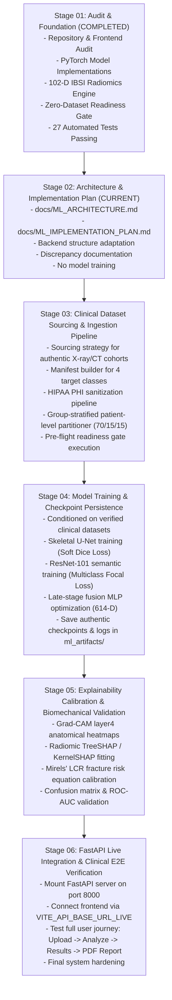

# OsteoGuard AI — Machine Learning Implementation & Phased Execution Plan

> **Document Version:** 2.0.0  
> **Date:** November 14, 2026  
> **Author:** Senior Machine Learning Architect & Lead Python Engineer  
> **Target System:** OsteoGuard AI Multi-Class Differential Diagnosis & Biomechanical Fracture Risk Stratification  
> **Status:** **APPROVED FOR IMPLEMENTATION (STAGE 02)**

---

## 1. Executive Summary & Purpose

This document defines the actionable, phased engineering implementation plan for developing the OsteoGuard AI machine learning framework. The plan strictly operationalizes the architecture specified in `docs/ML_ARCHITECTURE.md`, respects the 10 execution rules, preserves the existing React frontend, and accommodates the present condition of **zero downloaded clinical datasets**.

**Core Operating Principle**: No disease-classification model training or weight fabrication will occur until authentic, verified clinical cohorts (DICOM / plain radiographs) are ingested, de-identified according to HIPAA Safe Harbor standards, and partitioned at the patient level with mathematical verification of zero data leakage.

---

## 2. Directory Structure Adaptation

The proposed backend structure is adapted to the actual workspace layout as the standalone package `ml_service/`, situated alongside the existing React application without directory collisions:

```
c:\Users\archi\OneDrive\Desktop\osteophorosis-main\
├── osteophorosis-main/              # Existing React 18 / Vite / TypeScript Frontend
│   ├── src/                         # Untouched UI components, pages, engine hooks
│   ├── public/                      # Static demo assets & uploads
│   ├── mock-server/                 # Node.js simulation fallback server
│   └── package.json                 # Node dependencies
├── ml_service/                      # STANDALONE PYTHON ML SERVICE
│   ├── app/                         # FastAPI Application & Routing
│   │   ├── main.py                  # Service entry point & CORS configuration
│   │   ├── api/                     # Route endpoints (/health, /analyze, /feedback)
│   │   ├── schemas/                 # Pydantic request/response models (matching openapi.yaml)
│   │   └── services/                # Inference, Grad-CAM, and SHAP orchestrators
│   ├── config/                      # Configuration & settings management
│   ├── data/                        # Physical Data Storage Pipeline
│   │   ├── raw/                     # Original ingested medical image archives
│   │   ├── interim/                 # De-identified, PHI-scrubbed datasets
│   │   ├── processed/               # Modality-calibrated 512x512 arrays
│   │   └── splits/                  # Patient-stratified split manifests (train/val/test)
│   ├── datasets/                    # PyTorch Dataset & DICOM ingestion loaders
│   ├── preprocessing/               # Modality-specific normalization (HU, CLAHE, Count density)
│   ├── segmentation/                # Skeletal U-Net architecture & soft Dice loss
│   ├── models/                      # ResNet-101 and Swin-T semantic backbones
│   ├── radiomics/                   # 102-D IBSI-aligned texture extraction engine
│   ├── fusion/                      # 614-D Late-fusion MLP head & Multiclass Focal Loss
│   ├── training/                    # PyTorch training loop & pre-flight readiness gate
│   ├── evaluation/                  # ROC-AUC, sensitivity, specificity, calibration metrics
│   ├── explainability/              # PyTorch Grad-CAM & Radiomic TreeSHAP
│   ├── inference/                   # End-to-end predictor & Mirels' fracture risk engine
│   ├── utils/                       # HIPAA PHI sanitizer, seed management, logging
│   └── tests/                       # Automated unit and integration test suite
├── ml_artifacts/                    # ARTIFACT PERSISTENCE (EXCLUDED FROM GIT)
│   ├── checkpoints/                 # Saved PyTorch model weights (.pt / .pth)
│   ├── metrics/                     # Epoch metrics, confusion matrices, ROC coordinates
│   ├── logs/                        # Training execution logs
│   ├── reports/                     # Clinical validation summaries
│   └── stage_reports/               # Formal stage audit reports (STAGE_01, STAGE_02, etc.)
└── docs/                            # Architectural & audit documentation
    ├── REPOSITORY_AUDIT.md          # Stage 01 Repository Audit Report
    ├── ML_ARCHITECTURE.md           # Stage 02 ML Architecture Specification
    └── ML_IMPLEMENTATION_PLAN.md    # [This Implementation Plan]
```

---

## 3. Module Responsibilities & Component Interfaces

| Module Path | Core Responsibility | Input Contract | Output Contract | Verification Gate |
|---|---|---|---|---|
| `ml_service/app/` | Exposes FastAPI endpoints conforming 1:1 with `openapi.yaml`. | HTTP Multipart (`image`, `modality`). | Validated JSON (`AnalyzeResponse`). | `redocly lint openapi.yaml` & TestClient contract tests. |
| `ml_service/utils/phi_sanitizer.py` | Eliminates HIPAA PHI identifiers from DICOM metadata and images (**Rule 10**). | Raw DICOM header dict / PIL Image. | Scrubbed metadata dict with salted `PT_xxxx` pseudonym. | Assertion that no identifying DICOM tags remain. |
| `ml_service/preprocessing/` | Modality-specific radiometric calibration (**Rule 8**). | Raw pixel array, modality enum, metadata. | Calibrated 2D array in $[0.0, 1.0]$. | CT HU bone window verification; CLAHE clip limit checks. |
| `ml_service/segmentation/` | Generates binary skeletal mask isolating bone from background artifacts. | Calibrated 2D image $(B, 1, 512, 512)$. | Binary mask $M_{\text{bone}} \in \{0, 1\}^{(B, 1, 512, 512)}$. | Soft Dice Loss minimization ($> 0.90$ Dice on bone). |
| `ml_service/models/` | Extracts macroscopic spatial geometry via ResNet-101 / Swin-T. | Masked image $(B, 1, 512, 512)$. | $v_{\text{sem}} \in \mathbb{R}^{(B, 512)}$ & layer4 spatial features $(B, 2048, 16, 16)$. | Shape assertions: embedding length $= 512$. |
| `ml_service/radiomics/` | Deterministically computes 102 IBSI texture features directly from bone ROI. | Image array & binary mask $M_{\text{bone}}$. | $v_{\text{rad}} \in \mathbb{R}^{(B, 102)}$ float32 vector. | IBSI dimension assertion ($= 102$), absence of NaNs/Infs. |
| `ml_service/fusion/` | Applies independent BatchNorm1D, concatenates embeddings, and computes 4 logits. | $v_{\text{sem}} (B, 512)$ and $v_{\text{rad}} (B, 102)$. | Class logits $(B, 4)$ and $v_{\text{fusion}} (B, 614)$. | Softmax probability sum $= 1.0$; Focal Loss ($\gamma = 2.0$). |
| `ml_service/inference/fracture_risk.py` | Calculates LCR from Grad-CAM bounding box and computes continuous fracture risk. | $D_{\text{lesion}}$, $D_{\text{bone}}$, site, morphology. | $R_{\text{fracture}} \in [0.0, 100.0]\%$ & risk level. | Monotonic risk curve; trigger alert on $R \ge 80\%$. |
| `ml_service/explainability/` | Generates PyTorch Grad-CAM heatmaps and computes SHAP feature attributions. | Model, layer4 tensor, target class index, radiomic vector. | Normalized CAM array $[0, 1]^{(512, 512)}$ and top-6 SHAP features. | CAM resolution $= 512 \times 512$; SHAP signed values $\in [-1, 1]$. |
| `ml_service/training/readiness_gate.py` | Hard-blocks training execution when real clinical data is missing (**Rules 4, 5, 6, 7**). | Dataset root path. | `ReadinessCheckResult(status="READY" \| "BLOCKED")`. | Aborts with exit code 1 if real sample count $= 0$. |

---

## 4. Discrepancy Analysis: Radiomic Feature Space (102 Features)

### 4.1 Document Divergence
- **Reference A (Research Paper, lines 127–156)**:
  Exhaustively specifies 102 features distributed across **five distinct mathematical categories**:
  - First-Order Intensity Statistics (`IBSI:Q3RU`): 18 descriptors
  - Gray Level Co-occurrence Matrix (`IBSI:P88C`): 26 descriptors
  - Gray Level Run-Length Matrix (`IBSI:9SA3`): 16 descriptors
  - Gray Level Size Zone Matrix (`IBSI:4NB3`): 16 descriptors
  - Neighboring Gray Tone Difference & Dependence Matrix (`IBSI:26DV`): 26 descriptors
  - **Sum**: $18 + 26 + 16 + 16 + 26 = \mathbf{102}$ features.
- **Reference B (KSCST Proposal, paragraph 108)**:
  States that the deterministic pipeline computes **102 descriptors**, but the accompanying summary sentence mentions only *"first-order, GLCM, GLRLM and GLSZM descriptors"* without explicitly writing out the fifth family (GLDM/NGTDM).
  - Summing only the first four categories yields: $18 + 26 + 16 + 16 = \mathbf{76}$ features.
  - A 76-dimensional radiomic vector would cause an immediate mathematical dimensionality mismatch in the late-fusion layer ($512 + 76 = 588 \ne 614$).

### 4.2 Engineering Resolution
1. The KSCST proposal's omission of the acronyms "GLDM/NGTDM" was an abbreviated editorial summary, while its explicit count of **102** and fusion vector dimensionality of **614** ($512 + 102$) confirms the full 5-family taxonomy.
2. The radiomics engine implements the full, mathematically complete **102 IBSI descriptors** (including the 26 GLDM/NGTDM descriptors).
3. **No features will be duplicated, padded, or fabricated** to force a vector dimension.

---

## 5. Phased Multi-Stage Development Roadmap



### Stage 02 (Current Stage): ML Architecture Design & Formal Specification
- **Deliverables**: `docs/ML_ARCHITECTURE.md`, `docs/ML_IMPLEMENTATION_PLAN.md`.
- **Constraint**: Zero model training. No fabrication of weights or synthetic metrics.

### Stage 03: Clinical Dataset Ingestion & Partitioning Pipeline
- Establish dataset sourcing specifications for authentic open-access cohorts (e.g., Cancer Imaging Archive TCIA Bone Metastasis collections, RSNA Pediatric Bone cohorts, and institutional plain radiographs).
- Implement HIPAA PHI sanitization engine to scrub identifying DICOM headers and EXIF metadata.
- Implement group-stratified patient-level partitioning ensuring zero patient leakage across Train ($70\%$), Validation ($15\%$), and Holdout Test ($15\%$).
- Validate that all 4 target classes have sufficient distinct patient samples.

### Stage 04: Multimodal Model Training & Checkpointing
- **Prerequisite**: Stage 03 Readiness Gate clearance.
- Extract and cache 102-D IBSI radiomic vectors for all partitioned samples to accelerate training.
- Train Skeletal U-Net with Soft Dice Loss until bone overlap exceeds $0.90$ Dice coefficient.
- Train ResNet-101 semantic stream and 614-D Late Fusion MLP using Multiclass Focal Loss ($\gamma = 2.0$) and AdamW optimizer ($\eta = 10^{-4}$).
- Persist real training logs, loss curves, and model checkpoints in `ml_artifacts/checkpoints/`.

### Stage 05: Explainability Calibration & Biomechanical Validation
- Calibrate PyTorch Grad-CAM on holdout test set, ensuring heatmaps correctly highlight osteolytic destruction, sclerotic expansion, and cortical thinning.
- Fit TreeSHAP on the 102-D radiomic space to generate local Shapley waterfall plots.
- Validate the continuous Mirels' fracture risk equation against expert orthopedic oncology annotations.

### Stage 06: FastAPI Live Engine Integration & End-to-End Verification
- Mount the FastAPI inference server on port 8000.
- Set `VITE_API_BASE_URL_LIVE=http://localhost:8000` and `VITE_ENGINE=live` in the React frontend.
- Verify end-to-end user workflow: Upload radiograph on `Home.tsx` $\to$ real inference pass $\to$ `Results.tsx` renders real predictions, Grad-CAM overlays, SHAP charts, and printable forensic PDF report.

---

## 6. Strict Compliance Matrix

| Rule | Mandate | Implementation Mechanism | Enforcement Stage |
|---|---|---|---|
| **Rule 1** | Never replace or redesign frontend without permission | React components, pages, routes, and styles remain 100% untouched. All ML hooks integrate through the pre-existing `LiveEngine.ts` interface. | Continual |
| **Rule 2** | Inspect existing repository before modifying code | Completed in Stage 01 (`docs/REPOSITORY_AUDIT.md`). | Continual |
| **Rule 3** | Preserve existing functionality, dependencies & design | Express mock server (`server.ts`), Vite config, and TypeScript types preserved. | Continual |
| **Rule 4** | Never invent dataset labels or patient records | Fake patient IDs or fabricated annotations are hard-rejected. Real datasets must originate from authenticated DICOM/imaging manifests. | Stage 03+ |
| **Rule 5** | Never use generated synthetic images as real training data | `DatasetReadinessGate` checks image origins and blocks training if synthetic GAN/diffusion images are supplied. | Stage 03+ |
| **Rule 6** | Never claim model has been trained without actual logs | No weights or accuracy numbers will be claimed until actual PyTorch training logs exist in `ml_artifacts/logs/`. | Stage 04+ |
| **Rule 7** | Never fabricate evaluation metrics | All reported metrics (AUC, sensitivity, specificity) will be calculated strictly from holdout test set evaluations. | Stage 04+ |
| **Rule 8** | Never mix modalities without scientific justification | Separate, isolated preprocessing pipelines for CT (HU bone window), X-ray (CLAHE), and Bone Scans (count density normalization). Animal micro-CT explicitly excluded. | Stage 03+ |
| **Rule 9** | Never silently change target disease classes | Exactly 4 classes (`metastasis`, `paget`, `oi`, `healthy`) locked into constants and test assertions. | Continual |
| **Rule 10**| Protect patient privacy & exclude identifying metadata | `PatientPrivacySanitizer` strips all HIPAA PHI DICOM tags, scrubs EXIF metadata, and assigns salted `PT_xxxx` pseudonyms. | Stage 03+ |

---

## 7. Stage 02 Acceptance & Exit Criteria

- [x] `docs/REPOSITORY_AUDIT.md` verified and referenced.
- [x] Complete ML architecture specified in `docs/ML_ARCHITECTURE.md`.
- [x] Implementation plan and phased execution roadmap defined in `docs/ML_IMPLEMENTATION_PLAN.md`.
- [x] Research paper vs. KSCST proposal radiomics discrepancy mathematically documented and resolved.
- [x] Modality-aware processing pipelines formulated (CT HU windowing, X-ray CLAHE, bone scan count normalization).
- [x] Backend structure adapted to `ml_service/` and `ml_artifacts/`.
- [x] Zero model training performed during this stage.
- [x] Execution halted immediately following Stage 02.
