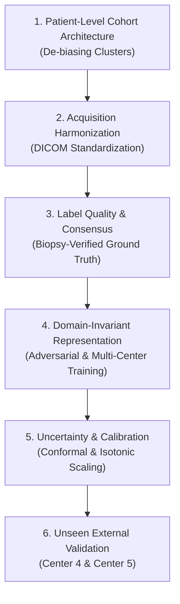

# Evidence-Based Remediation Roadmap for Multi-Center Generalization

**Project:** OsteoGuard AI — Unified Deep Learning & Differential Diagnostic Radiomic System  
**Stage:** 21 — BTXRD Multi-Center Generalization Audit  
**Artifact Path:** `ml_artifacts/btxrd_multicenter_audit/remediation_roadmap.md`  

---

## 1. Executive Remediation Directives

This roadmap details the concrete, evidence-based technical and clinical engineering priorities required to overcome the generalization gaps identified during Stage 19 (Center 2 Holdout) and Stage 20 (Center 3 Stress Test).

> [!CAUTION]
> **STRICT AUDIT BOUNDARIES — ZERO LEAKAGE DIRECTIVE:**  
> - **No Remediation in Stage 21:** This stage is strictly for auditing and reporting. Zero training or optimization is permitted.
> - **Permanent Sealing of Center 2 and Center 3:** Center 2 ($N=549$) and Center 3 ($N=259$) are **burned external holdout sets**. They must **NEVER** be incorporated into training, fine-tuning, architecture search, hyperparameter tuning, or post-hoc calibration fitting. Any future model iteration must be validated on genuinely new, untouched external cohorts.

---

## 2. Technical Remediation Pillars

### Pillar 1: Patient-Level Identifiers & Cluster-Robust Splitting
- **Current Limitation:** BTXRD provides image-level annotations without patient accession numbers, creating risks of intra-patient multi-view leakage.
- **Actionable Remediation:**
  1. Mandate cryptographic patient pseudonyms in all future data acquisition pipelines.
  2. Implement Group K-Fold splitting where all radiographs from a given patient remain exclusively in train, validation, or test partitions.
  3. Compute cluster-robust standard errors and clustered bootstrap confidence intervals during statistical reporting.

---

### Pillar 2: Dataset and Acquisition Protocol Harmonization
- **Current Limitation:** Inherent domain shift between hospital centers across detector technologies (computed radiography vs direct digital radiography), kVp/mAs exposure variations, and proprietary vendor post-processing edge-enhancement kernels.
- **Actionable Remediation:**
  1. Develop standard raw DICOM ingestion pipelines with photometric interpretation normalization (MONOCHROME1 vs MONOCHROME2 standardization).
  2. Implement adaptive histogram matching and anatomical window/level auto-calibration prior to tensor ingestion.
  3. Expand data augmentation during training to include contrast jittering, random gamma transforms, simulated detector noise, and edge-preserving bilateral filtering.

---

### Pillar 3: Label Quality, Histological Correlation & Multi-Reader Review
- **Current Limitation:** Radiology reports in retrospective open datasets may contain diagnostic noise, equivocal terminology, or lack definitive histological confirmation.
- **Actionable Remediation:**
  1. Establish multi-reader consensus protocols involving at least three board-certified musculoskeletal (MSK) radiologists.
  2. Restrict malignant tumor labels exclusively to cases with definitive biopsy-proven histological confirmation (e.g., osteosarcoma, chondrosarcoma, Ewing sarcoma).
  3. Classify borderline/intermediate lesions (e.g., giant cell tumors of bone, osteoblastomas) under a defined protocol or separate indeterminate category rather than forcing binary benign/malignant assignment.

---

### Pillar 4: Advanced Sampling & Class Imbalance Countermeasures
- **Current Limitation:** Fixed Focal Loss weighting ($\alpha=2.1850$) trained on Center 1 caused overcalling of pathology in Center 3 (Normal sensitivity dropped to 18.52%).
- **Actionable Remediation:**
  1. Implement dynamic prevalence-aware loss functions or Bayesian prior adjustment at inference time, allowing operating points to be adjusted according to known institutional referral pre-test probabilities.
  2. Introduce Balanced Softmax or Class-Dependent Logit Adjustment (Menon et al.) to naturally adjust decision boundaries to target deployment distributions.
  3. Explore Domain-Adversarial Training (DANN) or Maximum Mean Discrepancy (MMD) feature alignment to enforce domain-invariant representations across diverse imaging centers.

---

### Pillar 5: Rigorous Probability Calibration on Dedicated Development Cohorts
- **Current Limitation:** Multiclass Brier score escalated to 0.6486 in Center 3 under raw softmax inference.
- **Actionable Remediation:**
  1. Reserve an independent **Center 1 Calibration Split** ($N \approx 200$) strictly isolated from training backpropagation.
  2. Fit multi-class Temperature Scaling, Vector Scaling, or Dirichlet Calibration exclusively on this development calibration split.
  3. Implement Split Conformal Prediction to output calibrated prediction sets with guaranteed error rate bounds (e.g., $1-\alpha = 0.95$) rather than point softmax predictions.

---

### Pillar 6: Genuine External Holdout Benchmarks (Center 4 & Center 5)
- **Current Limitation:** Center 2 and Center 3 are now fully unblinded and cannot serve as blind validation targets for updated models.
- **Actionable Remediation:**
  1. Partner with new clinical centers (e.g., Center 4 community hospital, Center 5 academic medical center) to establish clean, sealed holdout cohorts.
  2. Ensure prospective or sealed retrospective collection with protocol pre-registration.

---

### Pillar 7: Explainability Review & Scientific Safeguards
- **Current Limitation:** Saliency maps can give a false sense of security or exhibit confirmation bias if not critically evaluated.
- **Actionable Remediation:**
  1. Apply Grad-CAM, HiResCAM, or Integrated Gradients to localize deep feature activations.
  2. Perform bounding-box intersection over union (IoU) between network attention maps and radiologist-delineated lesion margins.
  3. **Strict Scientific Policy:** Explicitly document that heatmap alignment does **not** equal algorithmic truth or causal reasoning; saliency maps must be presented as auxiliary localization hypotheses, never clinical proof.

---

## 3. Prioritized Implementation Timeline

| Phase | Remediation Milestone | Objective & Scope | Resource Requirement |
| :---: | :--- | :--- | :--- |
| **Phase A** | Patient-Level Data Governance | Re-index prospective cohorts with cluster IDs | Medical informatics & IRB approval |
| **Phase B** | Acquisition Standardization | Ingest DICOM metadata & normalize contrast | Engineering & image processing |
| **Phase C** | Histological Label Re-Audit | Biopsy-verified ground truth curation | MSK Pathology & Radiology panel |
| **Phase D** | Logit Adjustment & Calibration | Retrain with domain-invariant loss & temp scaling | GPU training cluster (Center 1 only) |
| **Phase E** | Center 4/5 Blinded Validation | Evaluate updated model on completely unseen hospitals | External multi-center consortium |

