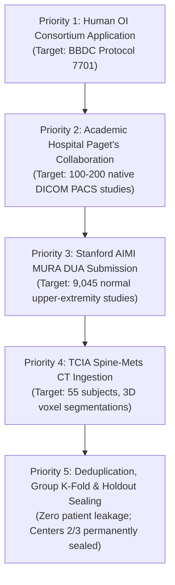

# Final Four-Class Acquisition Priorities and Status Gate

**Project:** OsteoGuard AI — Unified Deep Learning & Differential Diagnostic Radiomic System  
**Stage:** 23 — Verified Dataset Sources, Access and Acquisition Gate  
**Artifact Path:** `ml_artifacts/dataset_source_verification/final_acquisition_priority.md`  

---

## 1. Master Four-Class Diagnostic Status Gate

```
================================================================================
                    STAGE 23 FINAL ACQUISITION GATE
================================================================================

              NOT READY — DATA ACQUISITION REQUIRED

================================================================================
```

> [!CAUTION]
> **GOVERNANCE DIRECTIVE:**  
> Two target classes (**Paget's Disease of Bone** and **Osteogenesis Imperfecta**) have **ZERO** cases in the existing repository. Deep learning training for the unified four-class model cannot be initiated. Automated downloads and training remain **STRICTLY HARD-BLOCKED**.

---

## 2. Four-Class Status and Access Matrix

| Target Diagnostic Entity | Existing Verified Data | Best Candidate Source | Actual Access Status | Remaining Permissions | Modality Limitations | Next Acquisition Action |
| :--- | :--- | :--- | :---: | :--- | :--- | :--- |
| **1. Secondary Bone Metastasis** | 60 patients (120 images) in-tree (IICS-UNA) | IICS-UNA Paraguay (In-Tree) & TCIA Spine-Mets (`10.7937/kh36-ds04`) | **PUBLIC_DOWNLOAD_VERIFIED** (In-Tree) / **CONTROLLED_ACCESS** (TCIA) | TCIA Data Use Agreement | Scintigraphy and CT only; lacks plain X-ray radiographs | Use existing bone scan models for scintigraphy; submit TCIA DUA for CT |
| **2. Paget's Disease of Bone** | **0 patients, 0 images** | Academic Hospital MSK PACS Collaboration / Radiopaedia | **CONTROLLED_ACCESS_REQUEST_REQUIRED** / **EDUCATIONAL_ONLY** | Formal institutional IRB and Data Transfer Agreement | No open ML benchmark exists; educational cases legally barred from bulk ML | Transmit formal collaboration proposal to academic radiology partners |
| **3. Osteogenesis Imperfecta (OI)** | **0 patients, 0 images** | Brittle Bone Disorders Consortium (BBDC / RDCRN Protocol 7701) | **CONTROLLED_ACCESS_REQUEST_REQUIRED** | RDCRN DMCC approval & Institutional Review Board DUA | Pediatric skewed; requires BBDC consortium clearance | Submit formal research application to RDCRN DMCC |
| **4. Healthy Skeletal Control** | 1,600 clean radiographs in-tree (BTXRD C1 Normal) | Stanford AIMI MURA (`arXiv:1712.06957`) | **CONTROLLED_ACCESS_REQUEST_REQUIRED** | Electronic Stanford AIMI Research DUA registration | MURA is upper extremity only; BTXRD lacks patient IDs | Register on Stanford AIMI portal for MURA upper-extremity comparator |

---

## 3. Prioritized Execution Sequence



### Action Priority 1: Submit Application to BBDC / RDCRN for Human OI
- **Urgency:** Critical (0 cases in-tree; Figshare was disqualified as mouse micro-CT).
- **Target:** 40+ human pediatric participants with confirmed COL1A1/COL1A2 mutations.
- **Resource:** Use Request Template 1 from `dataset_access_request_templates.md`.

### Action Priority 2: Partner with Hospital MSK Radiology for Paget's Disease
- **Urgency:** Critical (0 cases in-tree; Radiopaedia bulk scraping legally barred).
- **Target:** 100–200 native 16-bit DICOM radiographs of Paget's disease across classic anatomical sites (pelvis, skull, tibia, spine).
- **Resource:** Use Request Template 2 from `dataset_access_request_templates.md`.

### Action Priority 3: Stanford AIMI Portal Registration for MURA Normal Controls
- **Urgency:** High (Eliminates dependence on trauma-confounded FracAtlas negative images).
- **Target:** Ingest 9,045 radiologist-verified normal upper-extremity studies.
- **Resource:** Use Request Template 3 from `dataset_access_request_templates.md`.

### Action Priority 4: TCIA Spine-Mets NBIA Download for 3D CT Pathway
- **Urgency:** Medium (Expands secondary bone metastasis into volumetric CT).
- **Target:** 55 patients (108 CT series with voxel segmentations, ~20.36 GB).

---

## 4. Preservation of Burned Holdouts

> [!IMPORTANT]
> **PERMANENT HOLDOUT SEALING:**  
> - BTXRD Center 2 ($N=549$) and Center 3 ($N=259$) remain **permanently burned holdouts**.
> - They must **NEVER** be incorporated into training, tuning, or calibration for the final four-class architecture.
> - Prospective multi-center evaluation will occur on freshly acquired external hospital cohorts.

