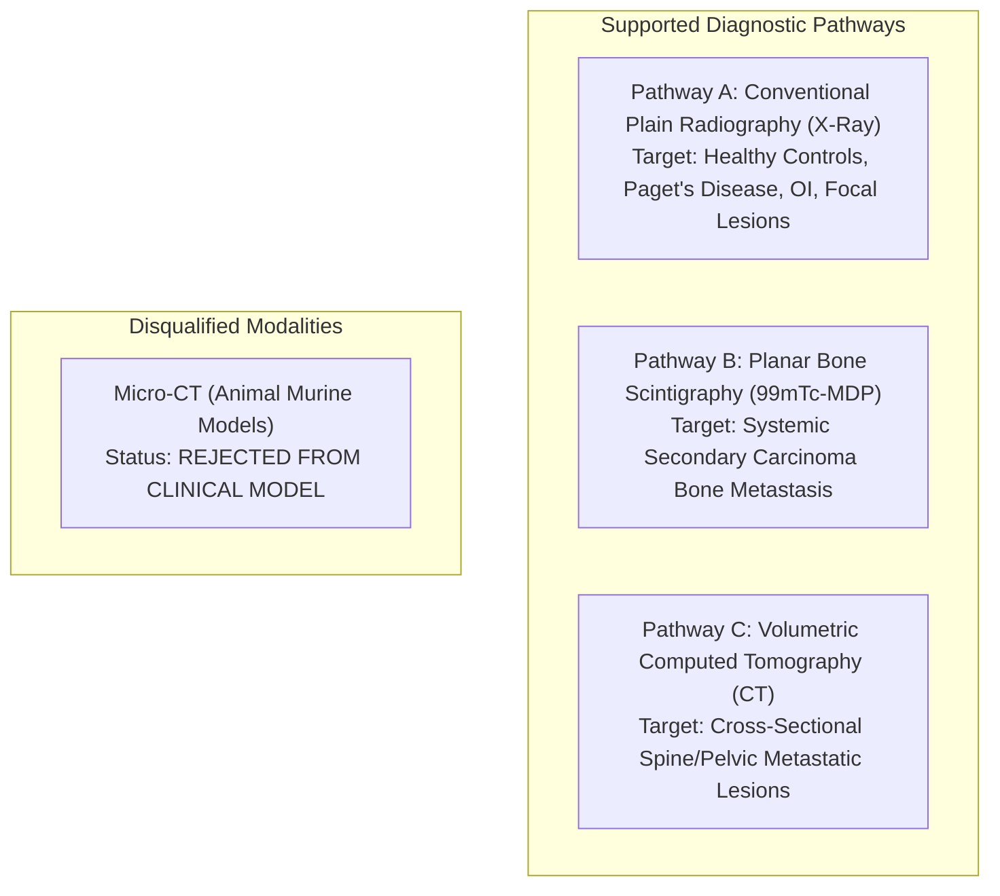

# Modality Compatibility Decision and Architectural Alignment

**Project:** OsteoGuard AI — Unified Deep Learning & Differential Diagnostic Radiomic System  
**Stage:** 23 — Verified Dataset Sources, Access and Acquisition Gate  
**Artifact Path:** `ml_artifacts/dataset_source_verification/modality_compatibility_decision.md`  

---

## 1. Modality-by-Modality Clinical Alignment

The verified data candidates span four distinct imaging modalities, each governed by different physics, spatial resolutions, and diagnostic representations:

### Detailed Modality Assessment:

| Imaging Modality | Physical Basis | Spatial Resolution | Diagnostic Role | Target Class Mapping | Modality Decision |
| :--- | :--- | :--- | :--- | :--- | :---: |
| **1. Plain Radiography (X-ray)** | 2D X-ray transmission attenuation | Sub-millimeter (<0.2 mm) | Cortical thickness, trabecular pattern, fracture lines, deformity | Healthy Controls, Paget's Disease, OI | **APPROVED FOR PATHWAY A** |
| **2. Planar Bone Scintigraphy** | $^{99\text{m}}\text{Tc}$-MDP gamma emission | Low spatial (~5–10 mm); high metabolic | Whole-body osteoblastic bone remodeling turnover | Secondary Bone Metastasis (Breast cancer) | **APPROVED FOR PATHWAY B** |
| **3. Volumetric CT** | 3D cross-sectional Hounsfield units | Isotropic voxel (<1.0 mm) | Precise cortical erosion and 3D osteolytic/osteoblastic lesions | Secondary Bone Metastasis (Spine/Pelvis) | **APPROVED FOR PATHWAY C** |
| **4. Micro-CT** | High-energy micro-focal X-ray | Micro-meter (<20 $\mu\text{m}$) | Ex vivo specimen imaging of small rodents (*oim* mice) | None (Animal research only) | **STRICTLY DISQUALIFIED** |

---

## 2. Mandatory Architectural Separation Directives

> [!CAUTION]
> **REJECTION OF SINGLE SHARED ENCODER:**  
> 1. Resizing heterogeneous modalities to $512 \times 512$ and passing them into a single convolutional or Vision Transformer backbone is **strictly rejected**.
> 2. Convolutional filters optimized for high-frequency cortical edges in plain radiographs produce degenerate representations when applied to low-frequency, blurry radionuclide gamma scans.
> 3. Volumetric 3D CT matrices cannot be flattened or arbitrarily sliced into 2D without discarding spatial context across axial contiguous cuts.

---

## 3. Decoupled Architecture Blueprint

OsteoGuard AI must be architected as a **Multi-Stream Decoupled System** coordinated via an explicit clinical arbitrator:

1. **Pathway A (Plain Radiography Deep Classifier):**
   - *Input:* $512 \times 512$ single-projection DICOM radiographs.
   - *Architecture:* Pretrained ResNet-34 / Swin-T backbone.
   - *Target Classes:*
     - Class 0: Healthy Skeletal Control (MURA / BTXRD C1 Normal).
     - Class 1: Paget's Disease of Bone (Hospital PACS / Radiopaedia).
     - Class 2: Osteogenesis Imperfecta (BBDC / RDCRN).
2. **Pathway B (Nuclear Medicine Scintigraphy Classifier):**
   - *Input:* Paired $512 \times 256 \times 2$ Anterior and Posterior whole-body scans.
   - *Architecture:* Dual-view Siamese ResNet-18 (validated in Stages 11–14).
   - *Target Class:* Secondary Bone Metastasis vs Negative Staging.
3. **Pathway C (Volumetric CT Radiomic Pipeline):**
   - *Input:* 3D axial CT volumes normalized to bone window ($+400\text{ HU} \pm 1500\text{ HU}$).
   - *Architecture:* 3D CNN / 102-D IBSI compliant radiomic feature extractor.
   - *Target Class:* Secondary Spinal / Pelvic Bone Metastases (TCIA Spine-Mets).
4. **Late Fusion Clinical Arbitrator:**
   - Evaluates patients based on available clinical modalities. If a patient presents solely with plain radiographs, Pathway A executes independently. If whole-body scintigraphy is available, Pathway B executes and outputs calibrated risk probabilities without cross-modality tensor contamination.

---

## 4. Final Architectural Gate

In accordance with Stage 23 rules:
- **No architectural code will be implemented in this turn.**
- The decoupled architecture remains the authorized design specification for future implementation stages once authentic datasets are acquired.

