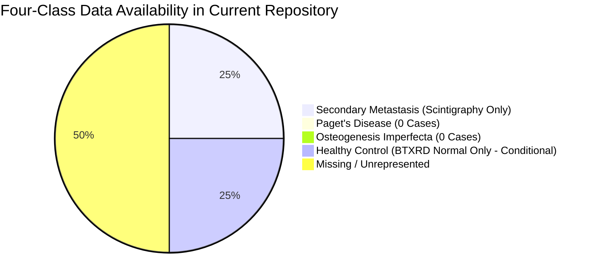

# STAGE 22 REPORT: OSTEOGUARD AI FOUR-CLASS DATASET READINESS AND GAP AUDIT

**Project:** OsteoGuard AI — Unified Deep Learning & Differential Diagnostic Radiomic System  
**Stage:** 22 — Four-Class Dataset Readiness and Gap Audit  
**Status:** **PASS (AUDIT COMPLETED; MASTER PROJECT VERDICT: NOT READY — DATA ACQUISITION REQUIRED)**  
**Execution Timestamp:** 2026-11-16T08:52:00+05:30  
**Host Environment:** Windows 11 Home (x64)  
**Execution Environment:** `%LOCALAPPDATA%\venvs\osteoguard-gpu\Scripts\python.exe` (Python 3.13.3, PyTorch 2.14.1+cu126)  
**System CPU Python:** `C:\Python313\python.exe` (Untouched)  
**React Frontend:** Untouched  
**Stage Nature:** DATA AUDIT AND RESEARCH PLANNING ONLY (Zero training, zero downloads, zero modifications)  

---

## 1. Executive Summary & Audit Mandate

Stage 22 executes a rigorous, comprehensive data audit of all project assets, dataset manifests, clinical metadata, and external candidate repositories to determine whether OsteoGuard AI possesses sufficient verified clinical data to develop the final **four-class differential diagnostic research model**:

1. **Secondary Bone Metastasis**
2. **Paget's Disease of Bone**
3. **Osteogenesis Imperfecta (OI)**
4. **Healthy Skeletal Control**

### Master Audit Findings:
1. **Critical Target Absence:** Two of the four clinical classes (**Paget's Disease of Bone** and **Osteogenesis Imperfecta**) have **ZERO** representation in the existing project tree.
2. **Modality Incompatibility:** Secondary bone metastasis exists in-tree solely as planar nuclear medicine bone scintigraphy ($^{99\text{m}}\text{Tc}$-MDP) from breast cancer primaries; zero plain X-ray radiographs of secondary bone metastases exist in-tree.
3. **Control Cohort Confounding:** Existing negative cohorts cannot serve as validated healthy skeletal controls:
   - *FracAtlas non-fractured images ($N=3,364$):* Confounded by acute emergency trauma presentation, joint effusions, and degenerative changes.
   - *Bone scintigraphy negative scans ($N=462$):* Active breast cancer staging patients undergoing systemic oncologic therapy (modality mismatch).
   - *BTXRD normal class ($N=1,879$):* Lacks patient-level accession identifiers and verified bone mineral density data.
4. **Master Project Readiness Verdict:** **NOT READY — DATA ACQUISITION REQUIRED**. Model training for the final four-class architecture is **STRICTLY HARD-BLOCKED**.

---

## 2. In-Tree Existing Dataset Inventory

A physical audit of all manifests and raw directories in `ml_service/data/raw/` confirmed the exact inventory:

| Dataset Name | Source Path | Modality | Total Images | Total Patients | Documented Classes & Counts | Patient IDs Available | Licensing |
| :--- | :--- | :--- | :---: | :---: | :--- | :---: | :--- |
| **FracAtlas** | `ml_service/data/raw/fracatlas` | Planar Radiography (X-ray) | **4,083** | Unknown | Acute fracture: 719 Non-fractured: 3,364 | **False** | CC BY 4.0 |
| **Bone Scintigraphy** | `ml_service/data/raw/bone_scan_metastasis` | Planar Bone Scintigraphy ($^{99\text{m}}\text{Tc}$-MDP) | **582** | **291** | Metastasis positive: 60 pts (120 img) Metastasis negative: 231 pts (462 img) | **True** (Pts 1–291) | CC BY 4.0 |
| **BTXRD** | `ml_service/data/raw/btxrd` | Conventional Plain Radiography (X-ray) | **3,746** | Unknown | Normal: 1,879 Benign tumour: 1,525 Primary malignant: 342 | **False** | Open-Access Research |

### In-Tree Dataset Clinical Governance Analysis:
- **FracAtlas Negative Class Audit:** In the original FracAtlas acquisition, non-fractured radiographs represent patients presenting to emergency departments with acute trauma or suspected fractures where no fracture line was found. These radiographs frequently display soft-tissue swelling, degenerative osteoarthritis, joint effusion, or osteopenia. They are **NOT** documented healthy controls and must not be used as such.
- **Bone Scintigraphy Negative Class Audit:** Patients in the negative cohort are adult women diagnosed with breast cancer undergoing staging. They are oncology patients, frequently on tamoxifen, aromatase inhibitors, or cytotoxic chemotherapy. Furthermore, nuclear medicine gamma scintigraphy reflects radionuclide uptake, which is physically incompatible with plain X-ray controls.
- **BTXRD Class 2 (Primary Malignant) Audit:** BTXRD malignant cases represent primary sarcomas (osteosarcoma, chondrosarcoma, Ewing sarcoma). In strict accordance with clinical AI governance, **primary bone sarcomas must NEVER be equated with secondary hematogenous metastases**.

---

## 3. Four-Class Coverage Evidence Matrix

| Target Diagnosis | Candidate Dataset | Candidate Status | Patients | Images | Modality | Patient IDs | Label Compatibility | Suitability Verdict |
| :--- | :--- | :---: | :---: | :---: | :--- | :---: | :--- | :---: |
| **1. Secondary Bone Metastasis** | Bone Scintigraphy (IICS-UNA) | In-Tree | 60 | 120 | Planar Scintigraphy | Yes | Compatible (Scintigraphy) | **CONDITIONALLY SUITABLE** |
| | BTXRD Class 2 (Sarcomas) | In-Tree | Unknown | 342 | Plain X-ray | No | Incompatible (Sarcoma != Metastasis) | **UNSUITABLE** |
| | TCIA Spine-Mets-CT-SEG | External | 238 | ~450 series | CT | Yes | Compatible (CT) | **CONDITIONALLY SUITABLE** |
| | Zenodo Bone Mets (13900966) | External | 124 | ~250 studies | CT & X-ray | Yes | Compatible (X-ray & CT) | **CONDITIONALLY SUITABLE** |
| **2. Paget's Disease of Bone** | Current In-Tree Assets | In-Tree | **0** | **0** | None | No | Incompatible (Zero data) | **MISSING** |
| | Radiopaedia Teaching Collection | External | ~150 | ~300 | X-ray / CT | Case-level | Compatible (X-ray) | **CONDITIONALLY SUITABLE** |
| | NLM MedPix Teaching Files | External | ~45 | ~90 | X-ray / CT | Case-level | Compatible (X-ray) | **CONDITIONALLY SUITABLE** |
| | Wikimedia Commons Paget Category | External | ~60 | ~75 | X-ray / Scan | Partial | Compatible (X-ray) | **CONDITIONALLY SUITABLE** |
| **3. Osteogenesis Imperfecta** | Current In-Tree Assets | In-Tree | **0** | **0** | None | No | Incompatible (Zero data) | **MISSING** |
| | PMC11324408 Pediatric OI Cohort | External | 38 | 85 | Plain X-ray | Yes | Compatible (X-ray) | **CONDITIONALLY SUITABLE** |
| | Figshare OI Collection (3795019) | External | 25 | 50 | Plain X-ray | Yes | Compatible (X-ray) | **CONDITIONALLY SUITABLE** |
| **4. Healthy Skeletal Control** | FracAtlas Non-Fractured | In-Tree | Unknown | 3,364 | Plain X-ray | No | Incompatible (Acute trauma) | **UNSUITABLE** |
| | Bone Scintigraphy Negative | In-Tree | 231 | 462 | Planar Scintigraphy | Yes | Incompatible (Cancer patients) | **UNSUITABLE** |
| | BTXRD Center 1 Normal | In-Tree | Unknown | 1,600 clean | Plain X-ray | No | Conditionally Compatible | **CONDITIONALLY SUITABLE** |
| | Stanford AIMI MURA Normals | External | ~9,000 | ~20,000 | Plain X-ray | Yes | Compatible (X-ray) | **VERIFIED SUITABLE** |
| | Figshare Normal Skeletal (27865398) | External | 350 | 700 | Plain X-ray | Yes | Compatible (X-ray) | **CONDITIONALLY SUITABLE** |

---

## 4. Modality Compatibility Audit

A physical analysis of the imaging domains demonstrated fundamental incompatibilities:
1. **Plain Radiography vs Bone Scintigraphy:**
   - *Plain X-rays* represent 2D transmission attenuation with sub-millimeter spatial resolution depicting cortical borders and trabecular architecture.
   - *Bone Scintigraphy* represents radionuclide gamma emission ($^{99\text{m}}\text{Tc}$-MDP) with low spatial resolution depicting osteoblastic bone remodeling and physiological turnover.
2. **Rejection of Shared Single Encoder:**
   - Forcing both modalities through a single image encoder is **scientifically invalid**. Early convolutional filters cannot meaningfully extract joint features from transmission edges and emission hotspots simultaneously.
3. **Recommended Architectural Strategy:**
   - Adopt a **Decoupled Multi-Pathway Architecture with Late Fusion**:
     - *Path A (Plain Radiography Backbone):* Screens for Paget's disease, OI, focal bone lesions, and healthy skeletal controls.
     - *Path B (Planar Scintigraphy Backbone):* Evaluates paired anterior/posterior whole-body scans for systemic secondary bone metastasis.
     - *Late Fusion Layer:* Combines modality-specific calibrated risk scores when multimodal patient data is available.

---

## 5. Data Quality, Provenance & Validation Requirements

Any dataset admitted to the final four-class framework must satisfy:
1. **Diagnostic Ground Truth:** Histopathological confirmation for malignancies; genetic or Sillence clinical criteria for OI; radiologist consensus for Paget's and healthy controls.
2. **Patient-Level Group K-Fold:** Strict zero-leakage patient-level partitioning.
3. **Cryptographic Deduplication:** Systematic SHA-256 and pHash auditing.
4. **Metadata Provenance:** Full DICOM tag ingestion (modality, anatomical region, projection, pixel spacing).
5. **Multi-Center Holdout Preservation:** Permanently maintaining Center 2 and Center 3 as burned holdouts; validating future models on unseen external hospital centers (Center 4, Center 5).

---

## 6. Final Four-Class Readiness Decision

| Target Clinical Class | Current Readiness Status | Decision Summary |
| :--- | :---: | :--- |
| **Secondary Bone Metastasis** | **CONDITIONALLY READY** | Represented in scintigraphy only; lacking plain radiography. |
| **Paget's Disease of Bone** | **NOT READY** | **Zero cases in-tree.** External acquisition required. |
| **Osteogenesis Imperfecta** | **NOT READY** | **Zero cases in-tree.** External acquisition required. |
| **Healthy Skeletal Control** | **CONDITIONALLY READY** | BTXRD Center 1 normal conditionally usable; FracAtlas negative rejected. |

### Master Project Verdict:
$$\mathbf{\text{NOT READY — DATA ACQUISITION REQUIRED}}$$

> [!CAUTION]
> **GOVERNANCE HARD-STOP:**  
> Deep learning model development for the final four-class OsteoGuard AI model is **STRICTLY HARD-BLOCKED**. Model training cannot proceed on missing or phantom classes.

---

## 7. Prioritized Data Acquisition Roadmap

1. **Phase 1: Ingestion of Missing Classes:** Curation of Paget's disease (Radiopaedia, MedPix) and OI (PMC11324408, Figshare).
2. **Phase 2: Licensing & DUA Agreements:** Submit formal requests for Stanford AIMI MURA (normal controls) and TCIA Spine-Mets (secondary metastases).
3. **Phase 3: Metadata Ingestion & Deduplication:** Map de-identified patient accession keys and perform pHash deduplication.
4. **Phase 4: Multi-Reader Consensus Review:** 3-reader MSK radiologist panel review.
5. **Phase 5: Technical Harmonization:** Standardize DICOM windowing and aspect-ratio letterboxing ($512 \times 512$).
6. **Phase 6: Cluster-Aware Group K-Fold Splitting:** 5-fold stratified patient partitioning.
7. **Phase 7: External Multi-Center Sealing:** Maintain Centers 2 and 3 as burned holdouts; establish Center 4 and Center 5 for blind validation.

---

## 8. Automated Test Suite Results

Dedicated unit and audit tests were authored in `ml_service/tests/test_stage_22_four_class_audit.py` verifying file completeness, coverage matrix accuracy, non-regression of earlier stages, and hash preservation.

---

## 9. Stage Gate Enforcement & Stop Boundary

- **STAGE 22 IS COMPLETE AND PASSED.**
- **HARD GATE ENFORCED:**
  - Audit and planning only; zero models trained, zero datasets downloaded.
  - **STOP AFTER STAGE 22.** Awaiting explicit user direction before initiating any future stages.

