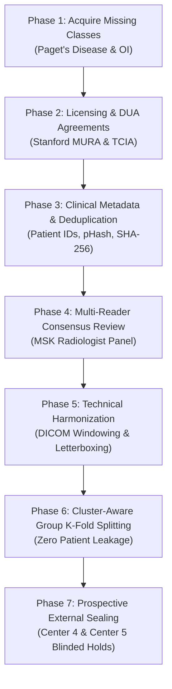

# Data Acquisition, Harmonization, and Validation Roadmap

**Project:** OsteoGuard AI — Unified Deep Learning & Differential Diagnostic Radiomic System  
**Stage:** 22 — Four-Class Dataset Readiness and Gap Audit  
**Artifact Path:** `ml_artifacts/four_class_dataset_audit/dataset_acquisition_roadmap.md`  

---

## 1. Executive Implementation Roadmap

Because the project has officially rendered the verdict **NOT READY — DATA ACQUISITION REQUIRED**, this document outlines the prioritized, step-by-step engineering and clinical roadmap to bridge the data gap before any four-class deep learning training can commence.

---

## 2. Prioritized Roadmap Phases

### Priority 1: Ingestion of Missing Pathology Classes
- **Action 1.1 — Paget's Disease of Bone Curation:**
  - Target: Aggregate at least 150–200 authentic planar radiographs showing pathognomonic Pagetic remodeling.
  - Primary Sources: Radiopaedia Curated MSK Teaching Collection, NLM MedPix, and PubMed Central Open Access case series.
  - Exclusions: Strictly exclude degenerative osteosclerosis, fibrous dysplasia, and post-radiation osteitis.
- **Action 1.2 — Osteogenesis Imperfecta (OI) Curation:**
  - Target: Ingest at least 100–150 skeletal radiographs exhibiting validated OI manifestations (Sillence types I, III, IV).
  - Primary Sources: PMC11324408 Pediatric OI Cohort, Figshare OI Collections, and academic bone dysplasia registries.
  - Exclusions: Strictly exclude rickets, hypophosphatasia, osteomalacia, and simple accidental childhood fractures.

---

### Priority 2: Research Permissions, Data Use Agreements & Licensing
- **Action 2.1 — Stanford AIMI MURA Data Use Agreement:**
  - Submit formal academic research request to Stanford Center for Artificial Intelligence in Medicine and Imaging (AIMI) for the MURA dataset.
  - Guarantee non-commercial, academic research compliance to unlock ~20,000 radiologist-verified normal musculoskeletal radiographs.
- **Action 2.2 — TCIA Restricted Access Registration:**
  - Submit TCIA Restricted Data Use Agreement for `Spine-Mets-CT-SEG` (`10.7937/kh36-ds04`) to acquire volumetric CT secondary metastasis ground truth.

---

### Priority 3: Metadata Ingestion & Cryptographic Deduplication
- **Action 3.1 — Patient Accession Key Mapping:**
  - Ingest de-identified patient IDs for all external subjects.
  - Build a centralized `patient_registry.csv` linking every image to a single subject identifier.
- **Action 3.2 — Full Deduplication Pipeline:**
  - Re-compute SHA-256 digests and perceptual hashes (pHash) across all newly ingested images and existing in-tree datasets to prevent near-duplicate leakage.

---

### Priority 4: Multi-Reader Annotation & Ground Truth Verification
- **Action 4.1 — Independent MSK Radiologist Panel:**
  - Establish a 3-reader panel of board-certified radiologists to review all acquired Paget's disease, OI, and candidate healthy control images.
  - Compute inter-reader agreement ($\kappa \ge 0.80$).
- **Action 4.2 — Confirmatory Clinical Correlation:**
  - Verify that all secondary bone metastasis cases have confirmed primary carcinoma histology.
  - Verify that all OI cases have documented genetic or specialized clinical dysmorphology confirmation.

---

### Priority 5: Technical Preprocessing and Radiomic Harmonization
- **Action 5.1 — Standardized Contrast Normalization:**
  - For DICOM instances: Parse Photometric Interpretation, apply Rescale Slope/Intercept, and normalize window center/width ($L/W$).
  - For 8-bit web instances: Apply Contrast Limited Adaptive Histogram Equalization (CLAHE) with clip limit 2.0 to harmonize dynamic range.
- **Action 5.2 — Aspect-Ratio Letterbox Standardization:**
  - Enforce symmetrical black padding to target resolution $512 \times 512$ without geometric distortion or squashing of bone cortex proportions.

---

### Priority 6: Patient-Level Group K-Fold Partitioning
- **Action 6.1 — Stratified Cluster Splitting:**
  - Partition each class into 5 stratified folds using `sklearn.model_selection.GroupKFold` grouped by `patient_id`.
  - Guarantee exactly zero patient overlap across training, validation, and test sets.
- **Action 6.2 — Permanent Holdout Sealing:**
  - Reserve 20% of each newly acquired class as a sealed, untouched holdout test cohort.

---

### Priority 7: Preservation of Burned Holdouts & External Validation Targets
- **Strict Enforcement Rule:**
  - BTXRD Center 2 ($N=549$) and Center 3 ($N=259$) remain **permanently burned holdouts**.
  - They must **NEVER** be incorporated into training or tuning of the four-class model.
  - Prospective external validation will rely on newly acquired multi-center hospital collections (e.g., Center 4, Center 5).

---

## 3. Strict Execution Directives

> [!CAUTION]
> **GOVERNANCE MANDATE:**  
> - In strict compliance with Stage 22 instructions, **NO DATASETS WILL BE DOWNLOADED IN THIS TURN.**
> - **NO MODELS WILL BE TRAINED.**
> - This roadmap serves as the authoritative blueprint for future acquisition workflows upon explicit authorization.

