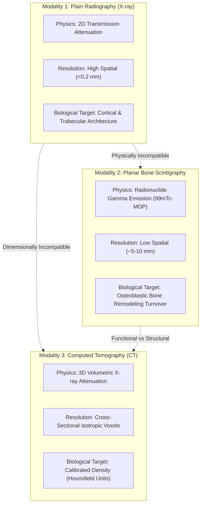

# Imaging Modality Compatibility and Architectural Feasibility Audit

**Project:** OsteoGuard AI — Unified Deep Learning & Differential Diagnostic Radiomic System  
**Stage:** 22 — Four-Class Dataset Readiness and Gap Audit  
**Artifact Path:** `ml_artifacts/four_class_dataset_audit/modality_compatibility_report.md`  

---

## 1. Executive Modality Assessment

The existing project data and prospective candidates span three fundamentally distinct medical imaging physics modalities:
1. **Conventional Plain Radiography (X-ray):** In-tree (FracAtlas, BTXRD) and candidate external cohorts (MURA, PMC11324408, Radiopaedia).
2. **Whole-Body Planar Bone Scintigraphy ($^{99\text{m}}\text{Tc}$-MDP):** In-tree (IICS-UNA Paraguay Bone Scan Dataset).
3. **Volumetric Computed Tomography (CT):** External candidate cohorts (TCIA Spine-Mets-CT-SEG).

> [!CAUTION]
> **FUNDAMENTAL SCIENTIFIC REALITY:**  
> Resizing images to $512 \times 512$ and applying standard ImageNet three-channel normalization ($\mu = [0.485, 0.456, 0.406]$, $\sigma = [0.229, 0.224, 0.225]$) does **NOT** make different imaging modalities physically or biologically interchangeable. Feeding a whole-body radionuclide scintigram into a convolutional network pre-trained on focal extremity radiographs is scientifically invalid and will produce degenerate representations.

---

## 2. Physical, Physiological, and Radiomic Modality Differences

### Detailed Modality Comparison:

| Modality Attribute | Conventional Plain Radiography (X-ray) | Planar Bone Scintigraphy ($^{99\text{m}}\text{Tc}$-MDP) | Volumetric Computed Tomography (CT) |
| :--- | :--- | :--- | :--- |
| **Physical Mechanism** | External X-ray beam transmission through tissue | Internal gamma-ray emission from injected radiopharmaceutical | Rotational X-ray tube attenuation reconstruction |
| **Image Dimensionality** | 2D single planar projection | 2D dual paired projection (Anterior + Posterior whole body) | 3D volumetric matrix of cross-sectional slices |
| **Spatial Resolution** | Very high (typically $1500 \times 2000$ pixels, sub-mm resolution) | Low spatial resolution ($256 \times 1024$ or $512 \times 1024$ matrix) | High isotropic 3D resolution ($512 \times 512 \times N$ slices) |
| **Information Domain** | Structural anatomy, cortical margins, trabecular bone pattern | Metabolic function, vascularity, osteoblastic turnover rate | Calibrated tissue radiodensity in Hounsfield Units (HU) |
| **Field of View** | Focal anatomical region (e.g., knee, wrist, spine, femur) | Total axial and appendicular skeleton in a single scan | Variable anatomical scan range (e.g., thoracolumbar spine) |
| **Typical Clinical Role** | First-line fracture, tumor, and structural deformity triage | Systemic cancer staging for disseminated skeletal metastases | Complex surgical planning, 3D cortical erosion assessment |
| **In-Tree Datasets** | FracAtlas ($N=4,083$), BTXRD ($N=3,746$) | IICS-UNA Breast Cancer Dataset ($N=291$ patients, 582 images) | None (TCIA candidate only) |

---

## 3. Evaluation of Architectural Strategies

Four potential architectural frameworks were audited for suitability in the final OsteoGuard AI differential system:

### Strategy 1: Shared Single Image Encoder (Early Fusion)
- **Concept:** Force all images (X-rays, bone scans, CT slices) through a single ResNet-50/Swin Transformer backbone by resizing and grayscale-to-RGB duplication.
- **Audit Verdict:** **REJECTED (INVALID)**.
- **Technical & Scientific Rationale:**
  1. A neural filter optimized for edge detection on bone cortices and trabeculae (e.g., LoG or Gabor-like filters in early conv layers) is biologically uninformative when applied to diffuse, blurry gamma-camera hotspots.
  2. The input distributions are non-stationary; training a single feature extractor on both modalities forces the network to learn conflicting representation manifolds, degrading classification accuracy across both tasks.

---

### Strategy 2: Modality-Specific Feature Encoders (Intermediate Specialization)
- **Concept:** Author dedicated, modality-tuned backbones:
  - *Radiography Pathway:* High-resolution ResNet-34/50 taking $512 \times 512$ single-projection X-rays with ImageNet transfer learning.
  - *Scintigraphy Pathway:* Dual-input Siamese or paired-channel ResNet-18 taking paired Anterior and Posterior whole-body scans ($512 \times 256 \times 2$) to capture spatial symmetry and contralateral hotspot differences.
  - *CT Pathway:* 3D CNN (e.g., Med3D / 3D ResNet-50) or 2D axial slice aggregator operating on Hounsfield-windowed tensors.
- **Audit Verdict:** **RECOMMENDED (FEASIBLE & SCIENTIFICALLY SOUND)**.
- **Technical & Scientific Rationale:** Preserves modality-specific spatial frequencies, physical priors, and diagnostic feature semantics without cross-modality feature corruption.

---

### Strategy 3: Late Fusion & Clinical Decision Routing (Multimodal Ensemble)
- **Concept:** Rather than forcing a single classification vector from one combined tensor, structure OsteoGuard AI as a **Hierarchical Decision System**:
  - **Module A (Plain Radiography Differential Classifier):** Evaluates plain X-rays for:
    - *Class 0:* Healthy skeletal control
    - *Class 1:* Paget's disease (architectural remodeling)
    - *Class 2:* Osteogenesis imperfecta (cortical thinning/deformity)
    - *Class 3:* Primary bone lesions / fractures
  - **Module B (Radionuclide Scintigraphy Metastasis Classifier):** Evaluates whole-body bone scans specifically for:
    - *Secondary Bone Metastasis* (systemic staging)
  - **Multimodal Late Fusion:** If a patient possesses both modalities, a late fusion meta-learner (e.g., calibrated logistic regression or Bayesian belief network) aggregates risk probabilities.
- **Audit Verdict:** **HIGHLY RECOMMENDED (CLINICALLY VALID)**.
- **Clinical Rationale:** In authentic hospital practice, a patient presenting for a plain knee radiograph does not have a whole-body bone scintigram unless already diagnosed with an advanced primary malignancy. Structuring the AI into clinically concordant pathways reflects authentic radiological workflows.

---

## 4. Final Architectural Recommendations

1. **Do Not Merge X-Rays and Bone Scans into a Single Training Set:** BTXRD and FracAtlas images must never be co-trained in the same batch or input stream as the IICS-UNA bone scans.
2. **Preserve Modality Identity in Metadata:** Any future multi-class dataset manifest must include mandatory columns for `modality` (`X_RAY`, `SCINTIGRAPHY`, `CT`) and `anatomical_region`.
3. **Adopt a Multi-Stream Decoupled Architecture:** Build the final four-class OsteoGuard AI framework around modality-specific specialized backbones coordinated via an explicit clinical late-fusion arbitrator.
4. **Implementation Gate:** In compliance with Stage 22 rules, **no architectural code or training pipelines will be implemented in this stage.**

