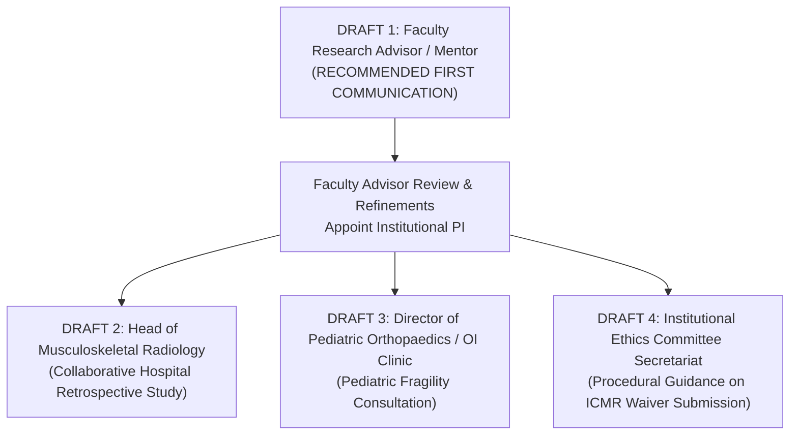

# Outreach Document Review and Engagement Sequence

**Project**: OsteoGuard AI Multi-Class Differential Diagnosis  
**Document Status**: Formal Outreach Communication Review  
**Date**: November 16, 2026  

---

## 1. Outreach Document Audit Summary

All draft outreach communications located in `ml_artifacts/document_corrections/stage24_corrected/outreach_email_drafts_REVISED.md` were reviewed for academic tone, institutional hierarchy, and regulatory compliance.

### Key Audit Findings
1. **Student-to-Faculty Tone**: The tone across all drafts has been revised to reflect appropriate academic deference from a student researcher seeking faculty mentorship and institutional guidance.
2. **Mandatory Non-Transmission Safeguard**: Every communication is prominently marked:  
   `*** DRAFT ONLY — STRICTLY PROHIBITED FROM TRANSMISSION WITHOUT INSTITUTIONAL APPROVAL ***`
3. **No Premature Claims**: All drafts eliminate claims of guaranteed co-authorship, high-impact publication, pre-existing institutional partnerships, or granted ethical waivers.
4. **Metric Accuracy**: All references to preliminary results accurately reflect verified three-center BTXRD metrics (Center 1: 0.8103, Center 2: 0.5069 [-37.44% relative], Center 3: 0.3592 [-55.67% relative]).

---

## 2. Recommended Outreach Execution Sequence

To respect institutional hierarchy and academic governance, the four email drafts must be deployed in strict sequential order:

### Stage 1: Faculty Advisor Review (Immediate Priority)
- **Document**: **Draft 1** (`Subject: Academic Guidance & Protocol Review: OsteoGuard AI Research Framework`).
- **Action**: The student researcher must present Draft 1 directly to their faculty supervisor.
- **Goal**: Secure faculty advisor sponsorship, agree on the appointment of the institutional Principal Investigator, and obtain feedback on protocol `OG-PROT-2026-04C-REVISED`.

### Stage 2: Secondary Departmental Outreach (Post-Faculty Approval)
- **Draft 2 (Radiology Chair)**: Sent only after faculty advisor endorsement, ideally co-signed by the faculty advisor, to explore hospital PACS collaboration for Paget's disease.
- **Draft 3 (Pediatric Orthopaedics)**: Sent to pediatric specialists to consult on bone fragility and growth-plate confounders in Osteogenesis Imperfecta.
- **Draft 4 (IEC Secretariat)**: Submitted to the institutional research office to clarify local IEC submission deadlines and documentation formats under ICMR Guidelines (2017).
