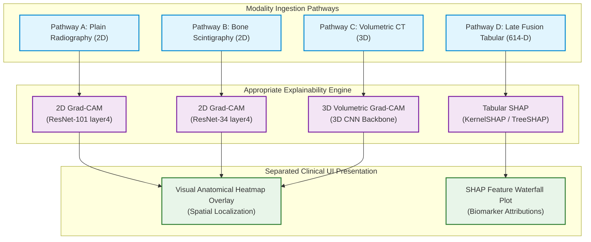

# Multimodal Explainability Architecture & Integration Blueprint

**Document Version**: 1.0.0  
**Project**: OsteoGuard AI  
**Date**: November 16, 2026  
**Status**: **ARCHITECTURAL BLUEPRINT (PRE-CLINICAL)**

---

## 1. Modality-Specific Explanation Mapping

The OsteoGuard AI research proposal specifies a synchronized dual-stream architecture combining macroscopic deep vision representations with high-frequency radiomics and biomechanical metrics.

---

## 2. Architectural Guidelines & Disclaimers

### 2.1 Strict Separation of Heatmaps and Tabular Scores
- **No Pseudo-Metric Conflation**: Spatial Grad-CAM heatmaps and tabular SHAP feature attributions address fundamentally different mathematical entities. They must be presented in separate UI panels and NEVER collapsed into a single unsupported "confidence score".

### 2.2 Causality vs. Attribution
- **Correlation, Not Causation**: SHAP values indicate how much a feature shifted the model's internal decision boundary relative to a background baseline. They do NOT prove biological or medical causality.

### 2.3 Grad-CAM Resolution Boundaries
- Grad-CAM maps reflect coarse features from deep convolutional layers (e.g. $16 \times 16$ or $7 \times 7$) upsampled to input resolution. They must never be represented to clinicians as precise anatomical segmentation boundaries.
