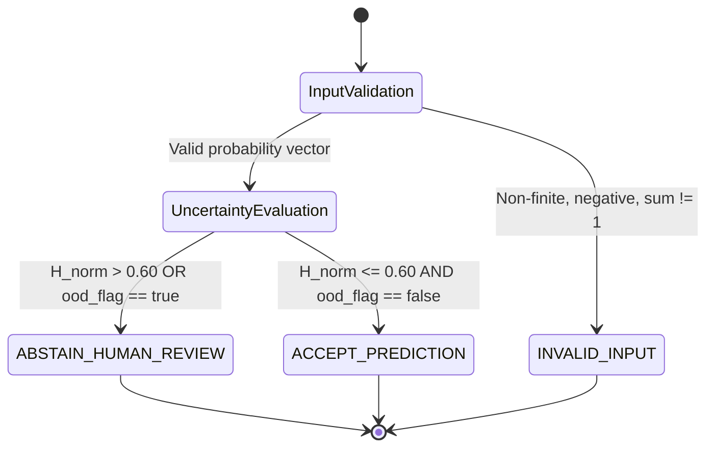

# Selective Prediction & Clinical Abstention Specification

**Document Version**: 1.0.0  
**Project**: OsteoGuard AI  
**Module**: `osteoguard.uncertainty.selective_prediction`  
**Date**: November 16, 2026  
**Status**: **ENGINEERING TRIAGE LOGIC VERIFIED**

---

## 1. Tri-State Decision Architecture

The selective prediction engine evaluates diagnostic outputs and assigns one of three mutually exclusive decision states:

### 1.1 Decision State Definitions
1. **`ACCEPT_PREDICTION`**:
   - Condition: $H_{\text{norm}} \le 0.60$ AND `ood_flag == false`.
   - Action: Output presented with high clinical confidence.
2. **`ABSTAIN_HUMAN_REVIEW_REQUIRED`**:
   - Condition: $H_{\text{norm}} > 0.60$ OR `ood_flag == true`.
   - Action: Prediction demoted to unverified suggestion; mandatory radiologist review container activated.
3. **`INVALID_INPUT`**:
   - Condition: Distribution validation failure.
   - Action: Pipeline aborted; error logged.

---

## 2. Abstention Reason Codes

| Reason Code | Trigger Condition | Clinical Interpretation |
| :--- | :--- | :--- |
| `ELEVATED_ENTROPY` | $H_{\text{norm}} > 0.60$, `ood_flag == false` | Ambiguity across differential classes exceeds safety limit. |
| `OUT_OF_DISTRIBUTION` | $H_{\text{norm}} \le 0.60$, `ood_flag == true` | Image features lie outside training manifold. |
| `COMBINED_ENTROPY_AND_OOD` | $H_{\text{norm}} > 0.60$, `ood_flag == true` | Dual hazard: highly dispersed probabilities and out-of-distribution manifold. |
| `AMBIGUOUS_TOP_MARGIN` | $\text{Margin} < \text{margin\_threshold}$ | Insufficient separation between top two candidate diagnoses. |
| `INVALID_PROBABILITY_VECTOR` | Validation exception | Mathematical integrity failure. |

> [!CAUTION]
> **Safety Invariant**: An abstention must **NEVER** be represented to the user or downstream systems as a "Negative" or "Healthy" diagnosis.
