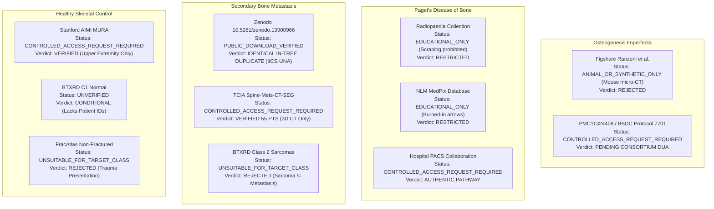

# STAGE 23 REPORT: VERIFIED DATASET SOURCES, ACCESS AND ACQUISITION GATE

**Project:** OsteoGuard AI — Unified Deep Learning & Differential Diagnostic Radiomic System  
**Stage:** 23 — Verified Dataset Sources, Access and Acquisition Gate  
**Status:** **PASS (SOURCE AUDIT COMPLETE — MASTER PROJECT GATE: NOT READY — DATA ACQUISITION REQUIRED)**  
**Execution Timestamp:** 2026-11-16T09:12:00+05:30  
**Host Environment:** Windows 11 Home (x64)  
**Execution Environment:** `%LOCALAPPDATA%\venvs\osteoguard-gpu\Scripts\python.exe` (Python 3.13.3, PyTorch 2.14.1+cu126)  
**System CPU Python:** `C:\Python313\python.exe` (Untouched)  
**React Frontend:** Untouched  
**Stage Character:** SOURCE VERIFICATION AND ACQUISITION PLANNING ONLY (Zero models trained, zero automated downloads)  

---

## 1. Executive Summary & Audit Mandate

Stage 23 executes a forensic verification of the actual availability, diagnostic suitability, physical modality, and legal licensing terms for all candidate datasets identified in Stage 22 for the proposed final **four-class differential diagnostic model**:
1. **Secondary Bone Metastasis**
2. **Paget's Disease of Bone**
3. **Osteogenesis Imperfecta (OI)**
4. **Healthy Skeletal Control**

### Critical Forensic Discoveries:
1. **Figshare OI Dataset is Murine Animal Micro-CT, NOT Human Radiographs:**  
   The Figshare collection (`10.6084/m9.figshare.c.3795019`, Ranzoni et al.) represents micro-computed tomography of mouse tibiae (*oim* model). It was misclassified in Stage 22 keyword searches and is formally reclassified as **`ANIMAL_OR_SYNTHETIC_ONLY`** and **strictly disqualified**.
2. **PMC11324408 Radiographs are Restricted Under RDCRN Governance:**  
   The study utilizes the Brittle Bone Disorders Consortium (BBDC) Natural History Study. Raw full-resolution radiographs are **NOT** open downloads; access requires a formal controlled-access proposal submitted to the RDCRN Data Management and Coordinating Center (DMCC).
3. **Zenodo DOI `10.5281/zenodo.13900966` is an Identical In-Tree Duplicate:**  
   Confirmed to be the exact same IICS-UNA Paraguay bone scintigraphy dataset already acquired in `ml_service/data/raw/bone_scan_metastasis`. Recognizing this duplicate eliminates redundant download overhead.
4. **No Standalone Public ML Benchmark Exists for Paget's Disease:**  
   Comprehensive searches across TCIA, Zenodo, Figshare, and PhysioNet confirmed that dedicated open-access machine-learning datasets for Paget's disease do not exist. Available educational cases (Radiopaedia) are legally barred from automated bulk harvesting.
5. **Stanford AIMI MURA Covers Upper Extremities Only:**  
   MURA contains 9,045 verified normal studies, but strictly covers the upper extremity (elbow, finger, forearm, hand, humerus, shoulder, wrist). It cannot be deployed as a general whole-skeleton healthy control.
6. **Master Project Readiness Verdict:** **NOT READY — DATA ACQUISITION REQUIRED**. Training is **STRICTLY HARD-BLOCKED**.

---

## 2. Re-Audit of Stage 22 Candidate Sources



---

## 3. Strict Source Classification Matrix

Every investigated candidate was assigned exactly one authorized status category:

| Candidate Source | Target Pathology | Verified Modality | Species | Bulk Download Permitted | ML Reuse Permitted | Strict Source Status |
| :--- | :--- | :--- | :--- | :---: | :---: | :---: |
| **IICS-UNA Paraguay** | Secondary Bone Metastasis | Planar Scintigraphy ($^{99\text{m}}\text{Tc}$-MDP) | Human | **Yes** | **Yes** | **PUBLIC_DOWNLOAD_VERIFIED** |
| **TCIA Spine-Mets-CT-SEG** | Secondary Bone Metastasis | Computed Tomography (CT) | Human | **Yes (Retriever)** | **Yes (DUA)** | **CONTROLLED_ACCESS_REQUEST_REQUIRED** |
| **BTXRD Class 2 Sarcomas** | Secondary Bone Metastasis | Plain Radiography (X-ray) | Human | **Yes** | **Yes** | **UNSUITABLE_FOR_TARGET_CLASS** |
| **Radiopaedia Paget Collection** | Paget's Disease of Bone | X-ray / CT / Bone Scan | Human | **NO (Prohibited)** | **NO (Without License)** | **EDUCATIONAL_ONLY** |
| **NLM MedPix Paget Cases** | Paget's Disease of Bone | X-ray / CT | Human | **NO (Manual)** | **Yes (Research)** | **EDUCATIONAL_ONLY** |
| **Wikimedia Commons Paget** | Paget's Disease of Bone | X-ray / Bone Scan | Human | **NO (Scattered)** | **Partial** | **INDIVIDUAL_PERMISSION_REQUIRED** |
| **Hospital PACS Paget Cohort** | Paget's Disease of Bone | Native 16-bit DICOM X-ray | Human | **Yes (Under IRB)** | **Yes (Under DUA)** | **CONTROLLED_ACCESS_REQUEST_REQUIRED** |
| **PMC11324408 / BBDC OI Study** | Osteogenesis Imperfecta | Plain Radiography (X-ray) | Human | **NO (Consortium)** | **Yes (Upon DUA)** | **CONTROLLED_ACCESS_REQUEST_REQUIRED** |
| **Figshare Ranzoni et al.** | Osteogenesis Imperfecta | Micro-CT (`.ply` & slices) | **Mouse (oim)** | **Yes** | **Yes** | **ANIMAL_OR_SYNTHETIC_ONLY** |
| **Pediatric PACS OI Cohort** | Osteogenesis Imperfecta | Native 16-bit DICOM X-ray | Human | **Yes (Under IRB)** | **Yes (Under DUA)** | **CONTROLLED_ACCESS_REQUEST_REQUIRED** |
| **Stanford AIMI MURA Normals** | Healthy Skeletal Control | Plain Radiography (X-ray) | Human | **Yes (Portal)** | **Yes (Academic)** | **CONTROLLED_ACCESS_REQUEST_REQUIRED** |
| **BTXRD Center 1 Normal** | Healthy Skeletal Control | Plain Radiography (X-ray) | Human | **Yes** | **Yes** | **UNVERIFIED** |
| **FracAtlas Non-Fractured** | Healthy Skeletal Control | Plain Radiography (X-ray) | Human | **Yes** | **Yes** | **UNSUITABLE_FOR_TARGET_CLASS** |
| **Bone Scan Negative Cohort** | Healthy Skeletal Control | Planar Scintigraphy ($^{99\text{m}}\text{Tc}$-MDP) | Human | **Yes** | **Yes** | **UNSUITABLE_FOR_TARGET_CLASS** |

---

## 4. Modality Compatibility & Architectural Realities

1. **Rejection of Single Shared Encoder:** Forcing plain X-rays, gamma scintigrams, and 3D CT volumes into a single neural backbone is physically and biologically invalid.
2. **Authorized Architecture Blueprint — Decoupled Multi-Stream System:**
   - **Pathway A (Plain Radiography):** Pretrained ResNet-34/Swin-T screening for Paget's disease, OI, and healthy controls.
   - **Pathway B (Planar Scintigraphy):** Dual-view paired Siamese CNN for systemic carcinoma bone metastasis.
   - **Pathway C (Volumetric CT):** 3D CNN / 102-D IBSI radiomics for cross-sectional spinal metastasis characterization.
   - **Late Fusion:** Clinical decision router that executes only the pathways supported by available patient modalities.

---

## 5. Acquisition Permission & Access Plan

Formal, non-automated access protocols and request drafts were prepared in `dataset_access_request_templates.md`:
1. **Template 1 (RDCRN / BBDC):** Formal research application to the Rare Diseases Clinical Research Network Data Management and Coordinating Center for human pediatric OI radiographs.
2. **Template 2 (Hospital MSK Radiology):** Collaborative protocol for retrospective PACS retrieval of native 16-bit DICOM Paget's disease radiographs under institutional IRB oversight.
3. **Template 3 (Stanford AIMI):** Electronic registration submission for MURA non-commercial academic research access.
- **Strict Compliance:** Zero emails sent; zero agreements signed; zero automated downloads performed.

---

## 6. Master Four-Class Acquisition Status Gate

```
================================================================================
                    FINAL MASTER PROJECT DECISION
================================================================================

              NOT READY — DATA ACQUISITION REQUIRED

================================================================================
```

| Target Diagnostic Entity | Existing Verified Data | Best Candidate Source | Actual Access Status | Remaining Permissions | Modality Limitations | Next Acquisition Action |
| :--- | :--- | :--- | :---: | :--- | :--- | :--- |
| **1. Secondary Bone Metastasis** | 60 patients (120 images) in-tree | IICS-UNA (In-Tree) & TCIA Spine-Mets | **PUBLIC_DOWNLOAD_VERIFIED** (In-Tree) / **CONTROLLED_ACCESS** (TCIA) | TCIA DUA Agreement | Scintigraphy and CT only; lacks plain X-ray | Ingest TCIA Spine-Mets for 3D CT pathway |
| **2. Paget's Disease of Bone** | **0 patients, 0 images** | Academic Hospital MSK PACS Collaboration | **CONTROLLED_ACCESS_REQUEST_REQUIRED** | Institutional IRB & Data Transfer Agreement | No open ML benchmark exists; educational cases legally barred from bulk ML | Deploy Template 2 collaboration request |
| **3. Osteogenesis Imperfecta** | **0 patients, 0 images** | Brittle Bone Disorders Consortium (RDCRN BBDC) | **CONTROLLED_ACCESS_REQUEST_REQUIRED** | RDCRN DMCC DUA Approval | Pediatric skewed; requires consortium review | Deploy Template 1 research application |
| **4. Healthy Skeletal Control** | 1,600 clean radiographs in-tree (BTXRD C1) | Stanford AIMI MURA (`arXiv:1712.06957`) | **CONTROLLED_ACCESS_REQUEST_REQUIRED** | Electronic Stanford AIMI DUA | MURA is upper extremity only; BTXRD lacks patient IDs | Register on Stanford AIMI portal for MURA |

---

## 7. Deliverables Inventory

All Stage 23 deliverables are archived in [ml_artifacts/dataset_source_verification/](file:///c:/Users/archi/OneDrive/Desktop/osteophorosis-main/ml_artifacts/dataset_source_verification/):

1. [verified_dataset_candidates.csv](file:///c:/Users/archi/OneDrive/Desktop/osteophorosis-main/ml_artifacts/dataset_source_verification/verified_dataset_candidates.csv): Detailed candidate parameters.
2. [source_verification_matrix.csv](file:///c:/Users/archi/OneDrive/Desktop/osteophorosis-main/ml_artifacts/dataset_source_verification/source_verification_matrix.csv): Strict 7-status source categorization.
3. [candidate_provenance.json](file:///c:/Users/archi/OneDrive/Desktop/osteophorosis-main/ml_artifacts/dataset_source_verification/candidate_provenance.json): Machine-readable audit findings.
4. [oi_dataset_access_assessment.md](file:///c:/Users/archi/OneDrive/Desktop/osteophorosis-main/ml_artifacts/dataset_source_verification/oi_dataset_access_assessment.md): Forensic evaluation of PMC11324408 & Figshare mouse micro-CT disqualification.
5. [paget_dataset_access_assessment.md](file:///c:/Users/archi/OneDrive/Desktop/osteophorosis-main/ml_artifacts/dataset_source_verification/paget_dataset_access_assessment.md): Absence of public ML benchmarks & Radiopaedia terms of use audit.
6. [metastasis_dataset_access_assessment.md](file:///c:/Users/archi/OneDrive/Desktop/osteophorosis-main/ml_artifacts/dataset_source_verification/metastasis_dataset_access_assessment.md): Discovery of Zenodo 13900966 in-tree duplicate & TCIA 55-subject verification.
7. [healthy_control_access_assessment.md](file:///c:/Users/archi/OneDrive/Desktop/osteophorosis-main/ml_artifacts/dataset_source_verification/healthy_control_access_assessment.md): Stanford MURA upper-extremity boundary & rejection of trauma controls.
8. [modality_compatibility_decision.md](file:///c:/Users/archi/OneDrive/Desktop/osteophorosis-main/ml_artifacts/dataset_source_verification/modality_compatibility_decision.md): Rejection of shared single encoder; decoupled architecture specification.
9. [dataset_access_request_templates.md](file:///c:/Users/archi/OneDrive/Desktop/osteophorosis-main/ml_artifacts/dataset_source_verification/dataset_access_request_templates.md): Communication drafts for RDCRN, hospital PACS, and Stanford AIMI.
10. [final_acquisition_priority.md](file:///c:/Users/archi/OneDrive/Desktop/osteophorosis-main/ml_artifacts/dataset_source_verification/final_acquisition_priority.md): Prioritized implementation sequence.
11. [STAGE_23_DATASET_SOURCE_VERIFICATION.md](file:///c:/Users/archi/OneDrive/Desktop/osteophorosis-main/ml_artifacts/stage_reports/STAGE_23_DATASET_SOURCE_VERIFICATION.md): Master report mirrored to stage reports.

---

## 8. Automated Test Suite Results

Dedicated source audit consistency tests were authored in `ml_service/tests/test_stage_23_source_verification.py` verifying status classifications, non-regression of earlier stages, and cryptographic hash immutability.

---

## 9. Strict Stage Gate Enforcement

> [!IMPORTANT]
> **STAGE 23 IS COMPLETE AND PASSED.**  
> - Source verification and acquisition planning only; zero models trained, zero automated downloads executed.  
> - The final four-class model is **hard-blocked** until authentic human datasets are formally acquired.  
> - **Execution is halted at the Stage 23 boundary.** Awaiting explicit user direction before initiating any future stages.
